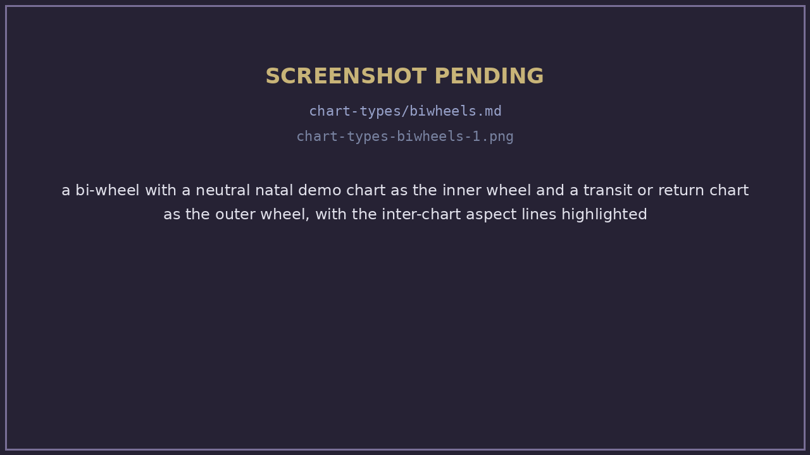

# Bi-Wheels &amp; Synastry

A **bi-wheel** overlays a second chart on top of the natal chart (the radix), drawing
the two side by side on one wheel so you can read them together. Zodiac highlights the
**key aspects between the two charts**, which makes the bi-wheel the tool for two common
jobs:

- **Synastry and comparison** — placing one person's chart against another's to see how
    their planets aspect each other.
- **Transits and returns against the natal chart** — laying a moment in time, or a
    [return chart](returns.md), over the birth chart to read the contacts it makes.

## Building a bi-wheel from events

The quickest way to get a bi-wheel is not to assemble one by hand. In the
[Events panel](../events/index.md), **clicking an event can make that moment chart #2
in a bi-wheel with the natal chart as chart #1** — so a transit, a return, or a
progressed contact you found in the table appears immediately as an overlay on the
radix, with its aspects to the birth chart drawn in.

<figure markdown="span">
  { loading=lazy }
  <figcaption>a bi-wheel with a neutral natal demo chart as the inner wheel and a transit or return chart as the outer wheel, with the inter-chart aspect lines highlighted</figcaption>
</figure>

## Prime-vertical bi-wheels

The bi-wheel has a **prime-vertical (mundoscope) mode** in which both charts are
coordinated in the same reference frame, so their positions can be compared correctly
rather than each drawn in its own frame. This mode is especially useful for seeing
angular coincidences — for example, when inspecting parans. How the coordinate frames
work, and when to switch to prime vertical, is covered in
[Prime vertical, equatorial &amp; great-circle](../chart-wheel/coordinate-frames.md).

## More than just the wheel

A bi-wheel is not limited to the drawn chart. The
[Harmonics tab](../chart-wheel/harmonics-tab.md) operates on bi-wheels too — clicking a
harmonic or midpoint redraws the aspects across *both* charts — and the primary
directions and PSSR tables can likewise be produced for the second chart in a bi-wheel,
optionally including the natal planets (see
[Primary directions &amp; quotidian modes](../parans/primary-directions.md)).
