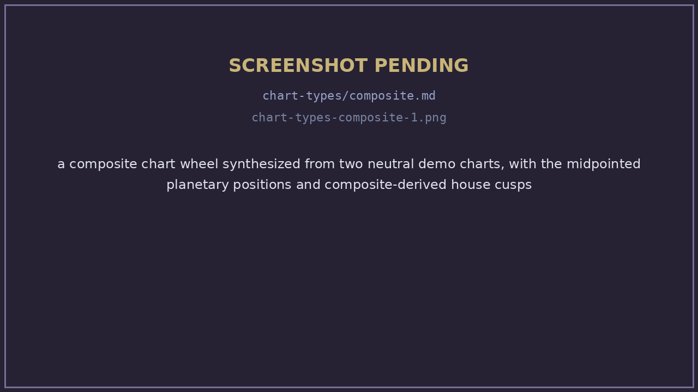

# Composite (Midpoint) Charts

A **composite chart** is a single chart that represents a *relationship* rather than a
person. Instead of overlaying two charts to compare them — the job of a
[bi-wheel](biwheels.md) — a composite blends them into one new chart by taking the
midpoint of each pair of positions.

## How Zodiac builds one

Zodiac synthesizes the composite from **two source files** — the two charts you want to
combine. For each body it computes the **midpoint** of the two positions, and those
midpointed positions become the planets of the composite chart. The house cusps are
**composite-derived**, so the resulting chart is a self-consistent whole that can be
read like any other chart in the program: drawn on the wheel, shown in the
[Tables view](../views/tables.md), and explored with harmonics and aspects.

Because a composite is a genuine chart in its own right, it can also be **progressed**.
Zodiac carries progressed-composite handling, so you can advance the composite in
symbolic time the same way you would a natal chart (see
[Progressions](progressions.md)).

<figure markdown="span">
  { loading=lazy }
  <figcaption>a composite chart wheel synthesized from two neutral demo charts, with the midpointed planetary positions and composite-derived house cusps</figcaption>
</figure>

## When to use it

Reach for a composite when you want the relationship itself as a single object of
study — one wheel whose planets and houses describe the combined pair. When instead you
want to see how two charts *interact* — which planets aspect which, transits against a
birth chart, or a synastry comparison — use a [bi-wheel](biwheels.md), which keeps the
two charts distinct and highlights the aspects between them.
