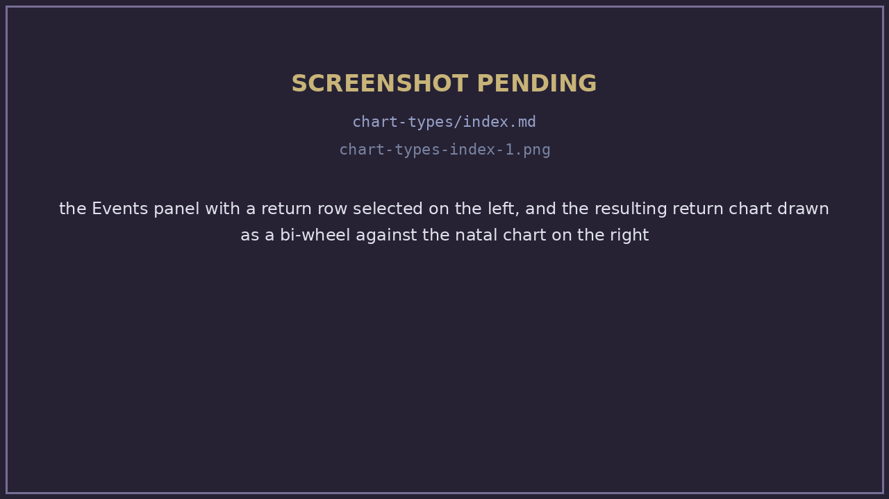

# Chart Types

A natal chart is only the starting point. From that one set of birth data Zodiac
derives a family of related charts — **returns**, **progressions**, **composites**,
and **bi-wheels** — each of which answers a different question about time,
development, or relationship.

The important thing to know is that you rarely have to hand-cast any of them. In the
spirit of the program's [table-based use model](../index.md), the
[Events panel](../events/index.md) surfaces the *moments* these charts describe — the
next solar return, a progressed contact, the exact hit of a transit — and clicking a
row brings up the derived chart, often as chart #2 in a bi-wheel with the natal chart.

<figure markdown="span">
  { loading=lazy }
  <figcaption>the Events panel with a return row selected on the left, and the resulting return chart drawn as a bi-wheel against the natal chart on the right</figcaption>
</figure>

## The derived charts

- **[Returns](returns.md)** — solar and sidereal returns, and (with a harmonic set)
    quarterly and demi-returns. They surface through the Events panel and feed
    primary-direction timing.
- **[Progressions](progressions.md)** — secondary progressions, tracked as events
    both to the natal chart and to the progressions themselves.
- **[Composite (midpoint) charts](composite.md)** — a single chart synthesized from
    two people's charts by midpointing their positions.
- **[Bi-wheels &amp; synastry](biwheels.md)** — overlaying a second chart on the natal
    chart to compare them, or to view transits and returns against the birth chart.
