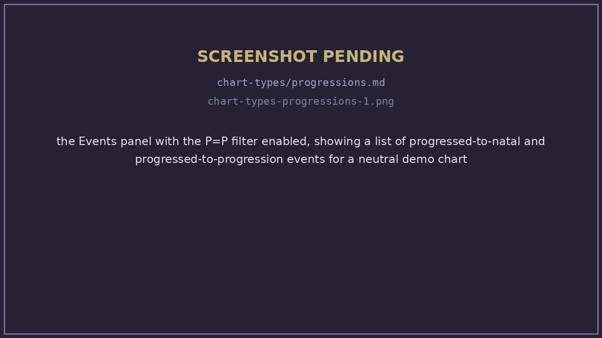

# Progressions

**Secondary progressions** advance a chart forward in symbolic time — the familiar
"a day for a year" technique — so that the slow unfolding of a life can be read against
the birth chart. Zodiac treats progressions the same way it treats every other kind of
moving contact: as **events** that you find in a table rather than charts you cast by
hand.

## Progressions as events

In the [Events panel](../events/index.md), progressions appear under the **P=P**
category, and the engine reports them in two directions:

- **Progressed-to-natal** — the progressed planets aspecting the positions they held
    at birth.
- **Progressed-to-progressions** — aspects that form between the progressed planets
    themselves as they advance.

Enable progressions in the [event-filter toolbar](../events/toolbar.md), give the panel
a date range, and Zodiac lists the progressed contacts that fall inside it in the same
dated, sorted table as your transits and returns. As with every event, clicking a row
brings up the corresponding chart, so you can see the progressed aspect drawn in
context — often as chart #2 in a bi-wheel against the natal chart.

Because progressions live in the shared events table, they can be filtered and
combined with other event types on a **per-tab** basis, and you can narrow a search to
specific bodies using the [pattern search language](../events/patterns.md) — for
example, restricting the list to the progressed contacts you care about rather than the
full set.

<figure markdown="span">
  { loading=lazy }
  <figcaption>the Events panel with the P=P filter enabled, showing a list of progressed-to-natal and progressed-to-progression events for a neutral demo chart</figcaption>
</figure>
