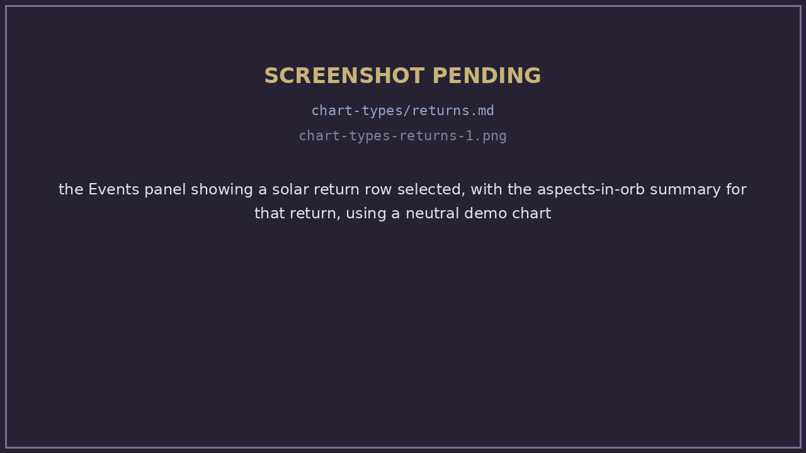

# Returns

A **return** chart is cast for the moment a planet comes back to the exact position
it held at birth. The most familiar is the **solar return** — the instant each year
when the transiting Sun regains its natal longitude — but Zodiac also casts
**sidereal returns**, so the technique works whichever zodiac you are studying in.

## Returns and the harmonic setting

Return charts respect the program's current harmonic setting, which opens up a
useful shortcut. Because a harmonic divides the circle into equal parts, asking for a
return while a harmonic is active gives you the nearest *sub*-return. Enter **H4** and
request a return and Zodiac generates the nearest **quarterly** return — a quarter of
the way around the Sun's cycle — which may of course be the full return itself. In the
same way you can reach **demi**-returns and other fractional returns simply by
choosing the harmonic first. See [Harmonics on the wheel](../chart-wheel/harmonics.md)
for how the harmonic display setting works elsewhere in the program.

## Finding returns through the Events panel

You do not have to know the date of a return to cast it. Enable returns in the
[event-filter toolbar](../events/toolbar.md), set a date range, and the
[Events panel](../events/index.md) lists every return that falls inside it, alongside
a summary of the aspects in orb at that moment. Clicking a return row brings up the
return chart — typically as chart #2 in a bi-wheel against the natal chart, so you can
read the return against the radix at a glance. Returns sit in the same table as
[stations and ingresses](../events/stations-ingresses.md), so a single search can
gather all the key annual moments together.

<figure markdown="span">
  { loading=lazy }
  <figcaption>the Events panel showing a solar return row selected, with the aspects-in-orb summary for that return, using a neutral demo chart</figcaption>
</figure>

## Returns and primary-direction timing

Return charts also feed the program's timing work: a solar return (including demi- and
quarti-solar returns) is the basis for **PSSR** timing — the primary
solar/sidereal-return method. That relationship is covered in
[Primary directions &amp; quotidian modes](../parans/primary-directions.md).
