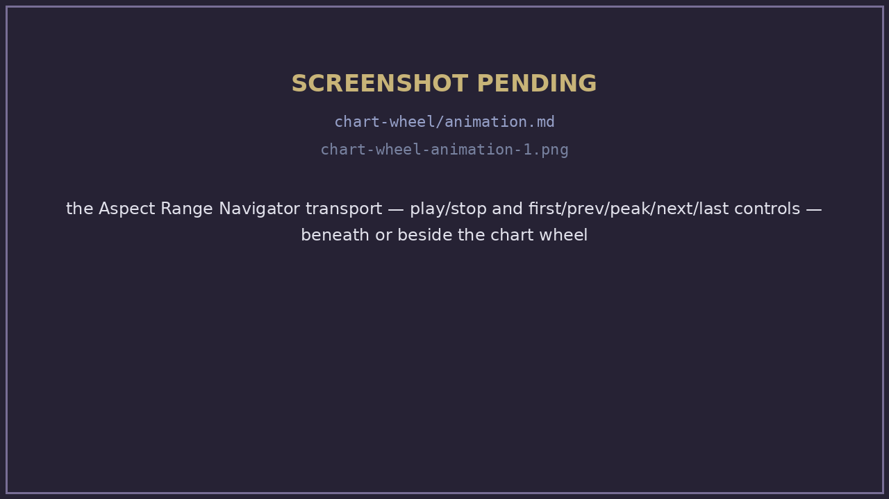

# Animation, Scrubbing &amp; Paran Cycling

The chart wheel doesn't have to hold a single moment. Zodiac can **animate** it through
time — playing or stepping through the events you found in the [Events panel](../events/index.md)
and watching the planets move around the wheel as an aspect comes into orb, peaks, and
separates.

<figure markdown="span">
  { loading=lazy }
  <figcaption>the Aspect Range Navigator transport — play/stop and first/prev/peak/next/last controls — in the title bar of the Events panel</figcaption>
</figure>

## The Aspect Range Navigator

Ranged aspect events — a transit that stays in orb over a span of days — are driven by
the **Aspect Range Navigator**, which sits in the **title bar of the Events panel**,
to the right of the panel name (it can be hidden in *Settings → Events*). Its
transport lets you **play** and **stop**, and step through the significant moments
of the range:

- **first / prev / peak / next / last** — jump to the start of the range, back one step,
    the moment of closest aspect, forward one step, or the end.

As it plays, the planets **slide around the wheel** in smooth discrete steps, with the
aspect lines **crossfading** and the glyphs tweening from one position to the next, so
you see the configuration form and dissolve rather than jumping between frames. When
cycling through paran events, the same first/prev/peak/next/last controls snap to the
focal paran moments.

## Rotation lock

During continuous playback, a **rotation lock** freezes the wheel's orientation. Without
it, keeping a moving Ascendant on the left edge would spin the whole ring while the
planets appeared to stay put. With the lock on, the ring holds still and the **planets
visibly sweep** around it — which is usually what you want to watch.

## Scrub mode

You can also **drag the wheel through time** directly. In **scrub mode**, dragging skips
the expensive recomputation that would otherwise fire on every intermediate moment, so
the drag stays responsive; when you release, Zodiac performs a single **exact catch-up**
recompute at the position you landed on. Play, pause, and resume remember where you
paused, so you can stop to examine a moment and pick up again from there.

## See also

Animation is the visual companion to the event list — find the events in the
[Events panel](../events/index.md), then play or scrub through them here. Paran cycling
connects to [Paranatellonta](../parans/paranatellonta.md).
