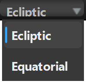

# Prime Vertical, Equatorial &amp; Great-Circle Aspects

By default, aspects are measured along the **ecliptic** — the familiar circle of the
zodiac. But the ecliptic is only one way to slice the sky, and some questions are
answered better in another frame. Zodiac lets you view and aspect a chart in coordinate
frames beyond the ecliptic, and the aspect mode can be chosen independently of the other
display settings.

## Prime vertical (PV / "mundoscope")

The **prime vertical** frame — sometimes called the **mundoscope** — redraws the chart
around the local horizon and meridian rather than the zodiac. This is the frame to use
when you want to know whether a body is *really* on the horizon or the meridian, as
opposed to merely sharing a degree of ecliptic longitude with an angle. It is especially
useful for inspecting **parans**, where what matters is exactly this angular placement;
see [Paranatellonta](../parans/paranatellonta.md).

!!! note "Rough edges"
    The prime-vertical **wheel rendering** has some known rough edges — the aspects are
    computed and displayed, but the drawn wheel is not yet perfectly correct in this
    mode. For bi-wheels, the PV display has been corrected so the two charts share a
    common reference frame, which makes it the better choice for visualizing paran
    coincidences between two charts.

## Equatorial aspects

You can also aspect in the **equatorial** frame, measured along the celestial equator
rather than the ecliptic. For equatorial *transits*, Zodiac uses an **"ex-precession"**
technique, which accounts for precession when comparing moving equatorial positions
against the natal chart.

## Great-circle mode

**Great-circle mode** measures aspects by the true **great-circle distance** between two
bodies on the sphere — the shortest arc joining them — rather than by their difference in
one coordinate. This is honored consistently across the program: both the chart wheel's
aspect display **and** the event search use great-circle distances when this mode is on,
so a search will find exactly the contacts the wheel draws.

<figure markdown="span">
  { loading=lazy }
  <figcaption>the aspect-mode selector in the status bar (Ecliptic / Equatorial); the GC (great-circle) and Mundane toggles sit beside it</figcaption>
</figure>
