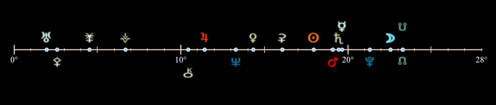

# The Declination Strip

Alongside the chart wheel, Zodiac can show a **declination strip** — a narrow panel that
plots each body's **declination** (its angular distance north or south of the celestial
equator) beside the others. Where the wheel shows longitude around a circle, the strip
lays the planets out by declination so you can read their north–south spread at a glance.

<figure markdown="span">
  { loading=lazy }
  <figcaption>the declination strip beside the chart wheel for a neutral demo chart, with planetary declination labels placed down the strip</figcaption>
</figure>

## What it's for

The strip makes **declination aspects** easy to spot:

- **Parallels** — two bodies at nearly the same declination on the *same* side of the
    equator (both north, or both south).
- **Contraparallels** — two bodies at nearly the same declination on *opposite* sides.

These are the declination analogues of the conjunction and opposition, and they can be
significant even when the bodies show no ordinary ecliptic aspect. Placing the
declinations side by side makes matching values line up visually, so parallels and
contraparallels stand out without arithmetic.

## Readable labels

When several planets sit at similar declinations their labels would naturally collide.
Zodiac uses **multi-pass label placement** to nudge the labels apart, reducing overlap so
the strip stays readable even in a crowded region.

## See also

For north–south angular relationships that involve the horizon and meridian rather than
the equator — parallels of a different kind — see the declination display mode of
**[the Speculum](../parans/speculum.md)**.
