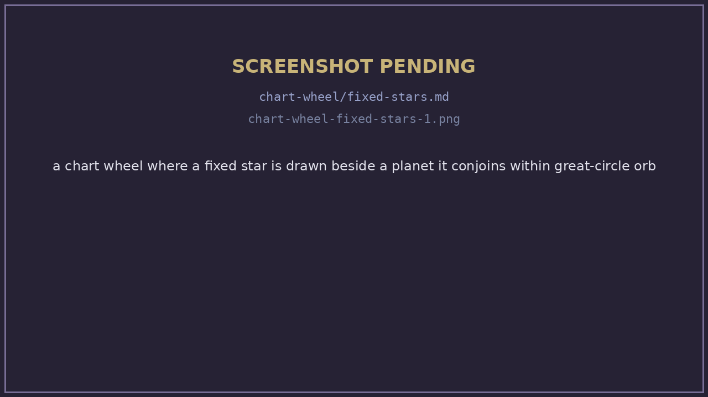

# Fixed Stars

The chart wheel shows **fixed stars that fall close to a planet**. Specifically, a star
is drawn when it lies within about **1.5° direct distance** of a planet — that is, the
true great-circle separation between the two points measured in two dimensions, not just
the difference in ecliptic longitude. A star that looks close by longitude but is well
off in latitude will not qualify, and rightly so: it isn't really near the planet on the
sphere.

<figure markdown="span">
  { loading=lazy }
  <figcaption>a chart wheel where a fixed star is drawn beside a planet it conjoins within great-circle orb</figcaption>
</figure>

## The philosophy behind it

Fixed stars are only shown when there is a real reason to consider them. The guiding
idea is that if a fixed star matters to a chart, it does so in one of two ways:

- It is **genuinely close to a planet in great-circle terms** — a tight conjunction on
    the sphere, which is what the ~1.5° direct-distance rule captures on the wheel; or
- It is **involved in a paran** with a planet — an angular coincidence, where the star
    and a planet reach the horizon or meridian together, regardless of how far apart they
    are by longitude.

Keeping the wheel to stars that pass the first test avoids cluttering it with dozens of
catalog stars that happen to share a degree of longitude but are nowhere near the planet
on the sphere.

## See also

The second kind of relevance — stars that matter because they share an angular moment
with a planet — is not a wheel-conjunction question at all. It is handled through parans:
see **[Paranatellonta](../parans/paranatellonta.md)** and **[the Speculum](../parans/speculum.md)**.
In the parans work, star-to-star parans are deliberately excluded and only the
planet-to-star parans that carry astrological meaning are kept.
