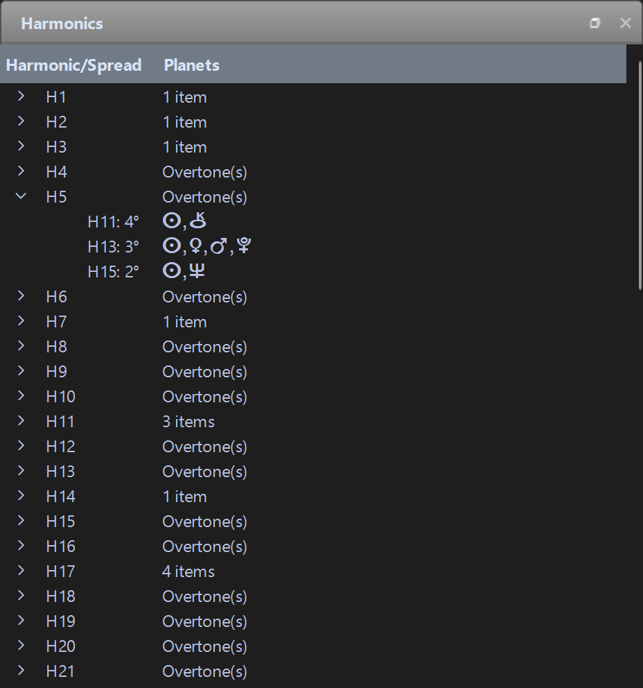

# The Harmonics Tab

The **Harmonics tab** is the list-and-navigate companion to the harmonic and midpoint
structures the [chart wheel](harmonics.md) can draw. Where the wheel shows the geometry,
this tab shows a **tree** of every harmonic aspect and midpoint in the chart, and lets
you click your way straight to any of them.

<figure markdown="span">
  { loading=lazy }
  <figcaption>the Harmonics tab showing the tree of harmonic aspects and midpoints, with an overtone child expanded under a harmonic group</figcaption>
</figure>

## Three ways to sort

The same list can be sorted three ways, depending on what you're hunting for:

- **By harmonic** — grouped by number (all the H4 contacts, all the H9 contacts, and so
    on).
- **By planetary combination** — grouped by the bodies involved, so you can see every
    harmonic relationship between, say, Sun and Saturn together.
- **By orb** — tightest contacts first, so the strongest relationships rise to the top.

## Overtones

The tree includes **overtones** — a way of seeing one harmonic's pattern nested inside
another. You can find the **H4 patterns (squares) inside an H9 chart**, or, the other way
around, the **H9 patterns (noviles) inside an H4 chart**. Overtones appear as child
entries beneath their parent harmonic.

The tab works for both **single wheels and bi-wheels**.

## Clicking through to the wheel

Clicking an entry drives the chart wheel directly:

- **Click a harmonic or midpoint entry** to highlight it and redraw the chart's aspect
    lines to focus those aspects, and/or switch the wheel to that harmonic.
- **++ctrl++-click a harmonic entry** to switch the wheel to that harmonic *and* set the
    bodies involved as **focal planets**.
- **Click an overtone child** to jump to its parent harmonic group and overlay that
    overtone's aspect set on the wheel for direct visual inspection.

You can copy a selected entry with **++ctrl+c++**.

!!! tip
    Clearing focal planets returns the wheel to H1 and resets any aspect-set override, so
    it's easy to get back to a clean radix view after exploring.

## See also

[Harmonics on the wheel](harmonics.md) covers the harmonic control and the dynamic
H1–H32 aspect display that these clicks drive.
