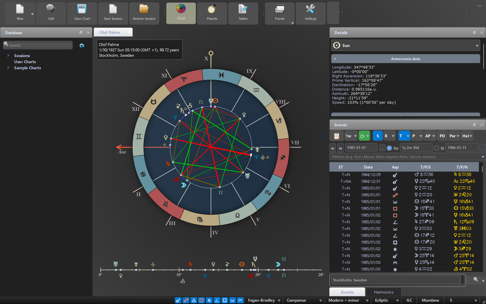

# Harmonics on the Wheel

Harmonics are a way of looking at a chart through a single number. In the *n*-th
harmonic, every position is multiplied by *n* and wrapped back into the circle, so that
planets which form an *n*-th-harmonic aspect in the natal chart — for example squares in
the fourth harmonic, or noviles in the ninth — line up as conjunctions. Zodiac lets you
explore this directly on the wheel, without casting a separate harmonic chart.

## The harmonic control

A **harmonic control** on the wheel lets you type a number and redraw the current chart
in that harmonic. The default is **H1** — the ordinary radix chart. Enter `4` and the
same wheel is redrawn in the fourth harmonic; return it to `1` for the natal view.
Because the harmonic is a view-level display setting, this switch is instant and never
creates a new chart file.

<figure markdown="span">
  { loading=lazy }
  <figcaption>the chart wheel redrawn in the 5th harmonic, with the harmonic selector at the right of the status bar set to 5</figcaption>
</figure>

## Dynamic harmonic aspect lines (H1–H32)

Rather than redrawing the whole wheel, you can also **overlay harmonic aspect lines**
from **H1 all the way to H32** on the ordinary chart. Each harmonic is toggled
individually from a row of **buttons on the status bar**, which appears when the
**Harmonic** aspect set is selected — click a harmonic's button to
add its aspect lines, click again to remove them. This makes it easy to build up exactly
the set of harmonics you want to see.

For example, the classical **Ptolemaic aspects** correspond to the harmonic set
**1 2 3 6 8** (conjunction, opposition, trine, sextile, and semi-square/sesquiquadrate),
so enabling just those buttons gives a traditional aspect picture.

As with ordinary aspects, **aspect intensity is shown by line thickness** — the closer
the aspect, the heavier the line — so the strongest harmonic contacts stand out even
when several harmonics are displayed together.

## See also

For a sortable, navigable list of every harmonic and midpoint structure in the chart —
including "overtones," which let you see one harmonic's pattern inside another — use the
**[Harmonics tab](harmonics-tab.md)**. Clicking an entry there can redraw the wheel's
aspect lines or switch the wheel to that harmonic for you.
