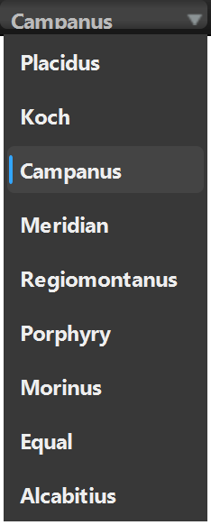

# House Systems &amp; Aspects

Two of the choices that most shape how a chart reads are the **house system** — how the
sky is divided into the twelve houses — and the **aspects** you count between bodies.
Zodiac lets you set both, and treats them as view-level display options: changing them
redraws the current chart without recasting it or marking the file as modified.

## House systems

Zodiac supports **nine house systems**, so you can draw the same chart under whichever
division your practice uses and compare cusps side by side. Because the house system is
a display setting, switching it simply redraws the wheel's cusps.

In some displays the houses are labeled with **house glyphs** rather than plain numbers,
which keeps a busy wheel readable and matches the glyph styling used elsewhere in the
program.

<figure markdown="span">
  { loading=lazy }
  <figcaption>the control listing the nine available house systems, with one selected</figcaption>
</figure>

## Aspects

Zodiac ships with a large aspect library — **over forty aspects** — reaching well beyond
the familiar conjunction, sextile, square, trine, and opposition into the minor and
harmonic aspects. You rarely want all of them drawn at once, so two controls keep the
wheel legible:

- **Aspect-set selection.** Choose which set of aspects is active — for example a
    classical Ptolemaic set, or a wider set that includes minor aspects — so only the
    aspects you care about are calculated and drawn.
- **Adjustable orbs.** Set how wide the allowance is for an aspect to count. Tighter
    orbs show only the closest contacts; wider orbs surface more, at the cost of a busier
    wheel.

The strength of each aspect that is drawn is shown by the **thickness of its line** — a
tighter, stronger aspect draws a heavier line than a loose one — so you can read the
important contacts at a glance. This intensity styling is shared with the harmonic
aspect display; see [Harmonics on the wheel](harmonics.md).

!!! tip "Harmonic aspects are handled separately"
    The forty-plus aspects here are the classic geometric ones. If you think of aspects
    as harmonics — squares as the fourth harmonic, noviles as the ninth, and so on — the
    dynamic H1–H32 display on [Harmonics on the wheel](harmonics.md) and the
    [Harmonics tab](harmonics-tab.md) is the more direct way to work.
