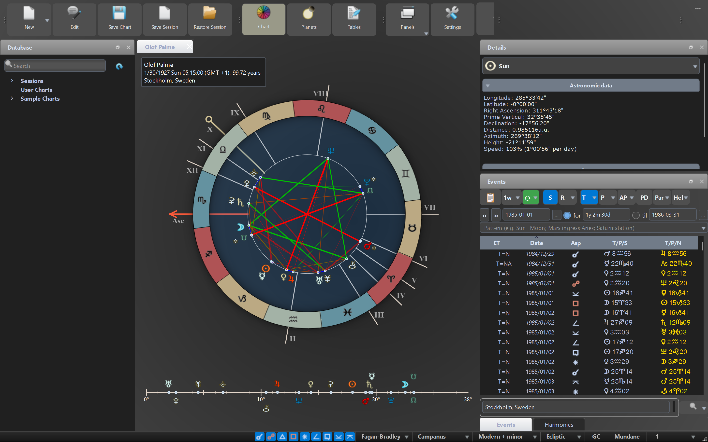

# The Chart Wheel in Depth

The chart wheel is Zodiac's central view — the round diagram of signs, houses,
planets, and aspects. It is more than a static picture, though. The wheel responds to
a set of *view-level* choices — which zodiac you read the chart in, which house system
and aspects you use, which harmonic you draw, and which coordinate frame you measure in
— and it can show layers that most charting programs leave to separate tools: fixed
stars, midpoint structures, a declination strip, and animated motion through time.

Because these are display settings rather than properties of the chart itself,
changing them never alters the saved chart or forces a recalculation of the underlying
data. You can move freely between a tropical and a sidereal reading, or redraw the same
wheel in the fourth harmonic, without casting anything new.

<figure markdown="span">
  { loading=lazy }
  <figcaption>the chart wheel filling the center of the window for a neutral demo chart, with the aspect-set and harmonic controls in the status bar</figcaption>
</figure>

## What's on these pages

- **[Zodiacs &amp; ayanamshas](zodiacs.md)** — tropical versus sidereal, the three
    sidereal ayanamshas, and how to switch.
- **[House systems &amp; aspects](houses-aspects.md)** — the nine house systems, the aspect
    library, adjustable orbs, and aspect-set selection.
- **[Harmonics on the wheel](harmonics.md)** — redraw the wheel in any harmonic and
    show dynamic harmonic aspect lines from H1 to H32.
- **[Fixed stars](fixed-stars.md)** — the stars the wheel shows near planets, and why.
- **[Midpoints](midpoints.md)** — how midpoint structures are drawn on the wheel.
- **[Prime vertical, equatorial &amp; great-circle](coordinate-frames.md)** — aspecting in
    frames beyond the ecliptic.
- **[The declination strip](declination-strip.md)** — a side-by-side view of
    declinations for parallels and contraparallels.
- **[Animation, scrubbing &amp; paran cycling](animation.md)** — playing, stepping, and
    dragging the wheel through time.

The related **[Harmonics tab](harmonics-tab.md)** lists and navigates the same harmonic
and midpoint structures the wheel can draw.
