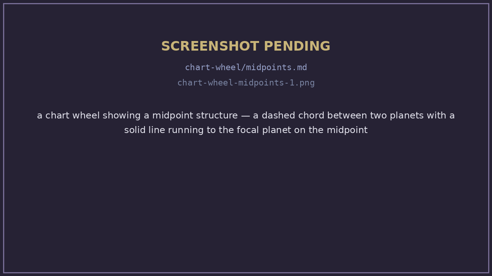

# Midpoints

A **midpoint** is the point exactly halfway between two planets, and midpoint work asks
which *third* body sits on that halfway point. Written in the usual shorthand, a midpoint
structure is **A = B/C**: planet A is at the midpoint of B and C. Zodiac can draw these
structures directly on the chart wheel, so you can see the geometry rather than reading
it off a table.

<figure markdown="span">
  { loading=lazy }
  <figcaption>a chart wheel showing a midpoint structure — a dashed chord between two planets with a solid line running to the focal planet on the midpoint</figcaption>
</figure>

## How midpoints are drawn

- **The B/C pair** is shown as a **dashed chord line** drawn directly between the two
    constituent planets.
- **The focal planet A** is joined to that structure by an **orb-weighted solid line** —
    the closer A sits to the exact midpoint, the heavier the line — so tight midpoint
    contacts stand out from loose ones at a glance.

## Midpoint-to-midpoint patterns

Zodiac also draws the more elaborate **A/B = C/D** case, where two different midpoint
pairs fall on the same axis. When two midpoint pairs share an axis like this, the wheel
connects them, again with orb-weighted line thickness, so these longer midpoint chains
are visible as a single structure.

## See also

Midpoints are closely related to harmonics — both are ways of finding hidden geometric
relationships in a chart — and the **[Harmonics tab](harmonics-tab.md)** lists a chart's
midpoints alongside its harmonic aspects, sortable and clickable. To search for the
*moment* a midpoint is triggered over a date range (for example `Ura/Plu=Nep`), use the
event engine's [pattern search](../events/patterns.md).
