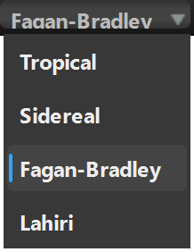

# Zodiacs &amp; Ayanamshas

Zodiac can draw a chart in either the **tropical** or a **sidereal** zodiac. The two
differ in where they place 0° Aries. The tropical zodiac ties 0° Aries to the vernal
equinox — the Sun's position at the start of spring — so the signs stay locked to the
seasons. A sidereal zodiac instead ties the signs to the stars, and because the equinox
slowly drifts against the stars (precession), a sidereal chart's degrees are offset from
the tropical ones by an amount called the **ayanamsha**.

## The sidereal options

Zodiac offers three sidereal schemes:

- **The original "constellational" sidereal** (listed as **Sidereal** in the zodiac
    selector) — inherited from the base program. This is
    a *non-equal*, 13-sign scheme meant to follow the actual constellations, which vary in
    width and can include Ophiuchus where the ecliptic crosses it. Some astrologers prefer
    this literal, star-boundary approach.
- **Fagan–Bradley** — an equal-sign, 30°-per-sign ayanamsha that fixes the star
    **Aldebaran at 15° Taurus**. It is the standard among Western sidereal practitioners.
- **Lahiri** — an equal-sign, 30°-per-sign ayanamsha that fixes **Spica at 0° Libra**.
    It is the common choice in Jyotish (Vedic) astrology.

The two equal-sign ayanamshas were added to the sidereal branch specifically for
western-sidereal and Vedic work; there is good evidence the Babylonians used
equal-portioned 30° signs, not just constellation boundaries.

!!! note "Apparent, not true, positions"
    Aspects are computed from **apparent** positions rather than true positions. Most
    commercial astrology software uses apparent positions, so this keeps Zodiac's
    results consistent with the tools you may be comparing against.

## Switching zodiac

The zodiac is a **view-level setting**: it controls how the current chart is displayed
and is not saved into the chart file. Changing it redraws the wheel without recasting
the chart, so you can compare a tropical and a sidereal reading of the same data freely.
The house system, aspect set, harmonic, and coordinate frame behave the same way — see
[House systems &amp; aspects](houses-aspects.md).

<figure markdown="span">
  { loading=lazy }
  <figcaption>the zodiac selector in the status bar, open to show Tropical, Sidereal, Fagan-Bradley and Lahiri</figcaption>
</figure>
