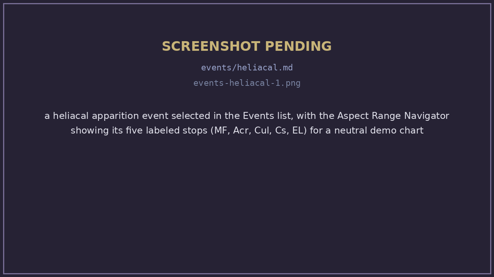

# Heliacal Apparitions

A heliacal event is about a body's **visibility** against the Sun — when it first rises
before dawn, when it is last seen after dusk, and the phases in between. Zodiac treats
these not as scattered points but as a single, navigable **apparition**, so you can step
through a body's whole season of visibility from one event. Turn them on with the
**Heliacal** toggle on the [event-filter toolbar](toolbar.md).

<figure markdown="span">
  { loading=lazy }
  <figcaption>a heliacal apparition event selected in the Events list, with the Aspect Range Navigator showing its five labeled stops (MF, Acr, Cul, Cs, EL) for a neutral demo chart</figcaption>
</figure>

## One apparition, not many points

For **fixed stars** and the **outer planets** (Mars, Jupiter, and Saturn), Zodiac reports
a single *apparition*: the arc of visibility running from the body's **morning-first
rising (MF)** to its **evening-last setting (EL)**. Rather than listing loose phase
points, it anchors the whole apparition at the body's **culmination (Cul)** — its
midnight meridian transit, which falls near opposition, when the body is highest and best
seen.

The [Aspect Range Navigator](../chart-wheel/animation.md) steps through **five labeled
stops** along the arc:

**MF** · **acronychal rising (Acr)** · **culmination (Cul)** · **cosmical setting (Cs)**
· **EL**

## A nuance worth understanding

**Acr** and **Cs** are *visibility* phases in the sense of Ptolemy's *Phaseis*, not
ordinary rise/set times:

- **Acronychal rising (Acr)** is the date the body rises **exactly at sunset**.
- **Cosmical setting (Cs)** is the date the body sets **exactly at sunrise**.

Crucially, these are **not** the rise and set of the culmination night. Each is computed
for the date on which that exact dusk or dawn coincidence actually occurs, so Acr and Cs
fall on **their own dates** — dates that can lie weeks away from the culmination, and can
even appear in a **counter-intuitive order** around it. This is expected: they mark
genuine astronomical phases, not events of a single evening.

## Other bodies

The apparition model fits the slow outer bodies. The faster ones are handled differently:

- **Inner planets (Mercury and Venus)** give **two greatest-elongation apparitions per
    synodic cycle** — one as a morning star, one as an evening star — rather than a single
    MF-to-EL arc.
- **The Moon** keeps its discrete **crescent events**, listed as individual occurrences.

In every case the events use the same discrete-occurrence transport as parans, so you can
step between them the same way you cycle paran moments.

---

**Next:** [Relocating an event](relocating.md) &nbsp;·&nbsp;
[Background finders &amp; performance](performance.md)
