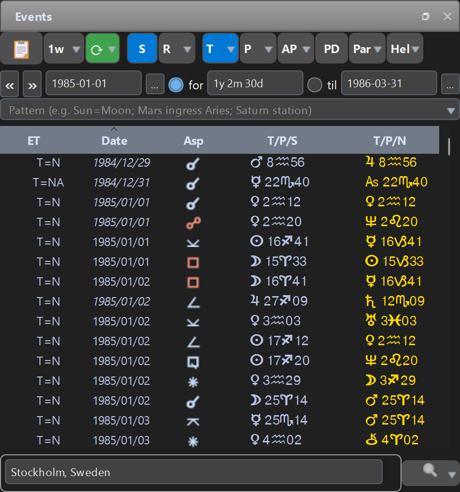

# Events (Transits)

The **Events** panel is where Zodiac looks *through time*. Instead of a single moment,
it searches a range of dates and lists the astrological events that fall inside it —
transits, progressions, stations, ingresses, returns, parans, and heliacal
apparitions — with the timing worked out for you. It is the most actively developed
part of the program, and the goal for it is simple: make finding events **quick, easy,
and powerful**.

<figure markdown="span">
  { loading=lazy }
  <figcaption>the Events panel down the right side of the window, with the filter toolbar at the top, a date range, and the scrolling list of dated events</figcaption>
</figure>

## What it finds

For a given chart and date range, the engine can report:

- **Transits to transits (T=T)** — aspects between the moving planets themselves.
- **Transits to natal (T=N)** — the moving planets aspecting the birth chart.
- **Progressions (P=P)** — secondary progressions, to natal and to progressions.
- **Stations** — where a planet turns retrograde or direct, including the surrounding
    shadow period.
- **Ingresses** — a planet entering a new sign.
- **Returns** — solar, sidereal, and (with a harmonic set) quarterly or demi-returns.
- **Parans** — planet-to-planet and planet-to-star angular coincidences (see
    [Parans &amp; Primary Directions](../parans/index.md)).
- **Heliacal apparitions** — a body's arc of visibility, from morning-first rising to
    evening-last setting (see [Heliacal apparitions](heliacal.md)).

Which of these appear is controlled by the [event-filter toolbar](toolbar.md) at the top
of the panel, and every setting is remembered **per tab**, so two charts open side by
side can be searching for entirely different things.

## Two ways to search

**Browse everything in range.** Leave the filters wide and Zodiac lists all the events
of the enabled types across your date span. This is fast: on an optimized build, about a
second for a year of transits-to-transits, transits-to-natal, returns, and stations —
and roughly four seconds if you sweep every harmonic from H1 through H32.

**Search for something specific.** Type a **pattern** into the search field and Zodiac
finds just those events. The pattern language is compact but expressive — a few
examples:

| You type | You get |
| --- | --- |
| `Sun=Moon` | Every lunation (Sun conjunct Moon) in range |
| `H4 Mars=Saturn` | Fourth-harmonic (square) contacts of Mars and Saturn |
| `Mars ingress Aries` | Mars entering Aries |
| `Saturn station` | Saturn's stations |
| `Ura/Plu=Sun-r` | The Uranus/Pluto midpoint contacting **radix** (natal) Sun |
| `Sun,Moon,Mars` | Three-body clusters of Sun, Moon, and Mars |

The full language — group tokens, harmonic prefixes, midpoints, exact multi-body
patterns, and the transit/natal/progressed suffixes — is covered in
[The pattern search language](patterns.md).

## Working with the results

- **Click an event** to load that moment on the chart wheel, so you can see the aspect
    in context.
- **Relocate it.** An event is normally tied to the chart's location, but you can edit a
    single event — locking its time zone — to cast it for somewhere else. See
    [Relocating an event](relocating.md).
- **Step or play through a range.** Ranged events (a transit that is in orb over a span
    of days) can be animated with the **Aspect Range Navigator** — play, stop, and step
    first / previous / peak / next / last — while the wheel animates the planets across it.
    See [Animation, scrubbing &amp; paran cycling](../chart-wheel/animation.md).
- **Skip the noise.** Each tab can skip events shorter than a chosen duration and
    auto-refresh on demand.

## Long searches don't freeze the program

Pattern searches can run in the background. A long search can keep going when you switch
to another tab, and paused or backgrounded finders reconnect and repopulate their
results when you return. See [Background finders &amp; performance](performance.md) for the
controls and the settings that govern them.

---

**Next:** [The event-filter toolbar](toolbar.md) &nbsp;·&nbsp;
[The pattern search language](patterns.md) &nbsp;·&nbsp;
[Heliacal apparitions](heliacal.md)
