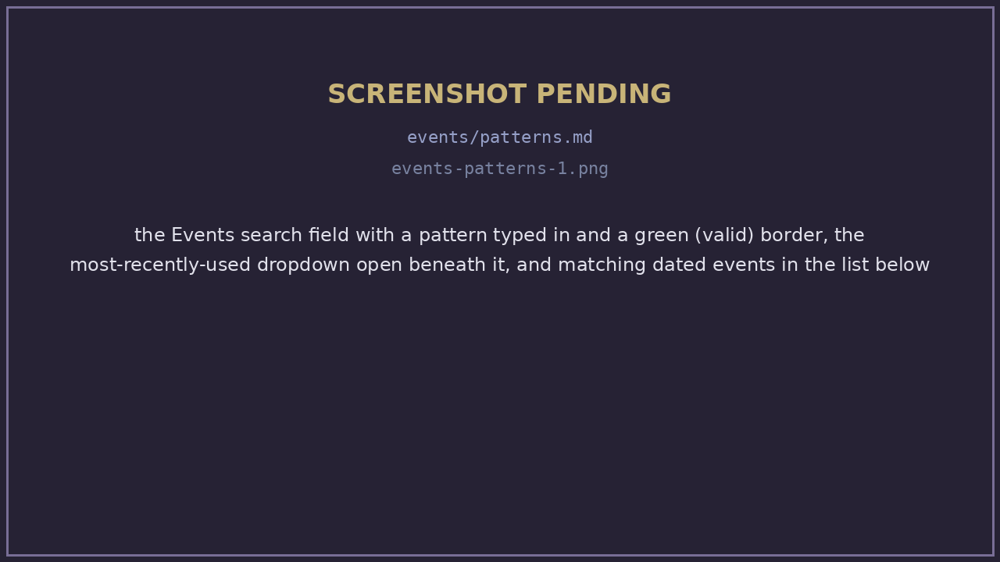

# The Pattern Search Language

The [event-filter toolbar](toolbar.md) is good at browsing everything in range. When you
want a *particular* event — the moment two specific planets square each other, a
midpoint contact, an ingress — you type a **pattern** into the Events search field and
Zodiac finds just those events. The language is compact but expressive, and it is the
quickest way to ask the engine a precise question.

<figure markdown="span">
  { loading=lazy }
  <figcaption>the Events search field with a pattern typed in and a green (valid) border, the most-recently-used dropdown open beneath it, and matching dated events in the list below</figcaption>
</figure>

## Building blocks

At its simplest a pattern names two bodies joined by `=`, which means "in aspect":
`Sun=Moon` finds every lunation (Sun conjunct Moon) in range. From there the language
adds patterns of three or more bodies, harmonics, ingresses, stations, midpoints, role
suffixes, and group tokens. Multiple patterns can be run at once by separating them with
a semicolon (`;`).

| You type | You get |
| --- | --- |
| `Sun=Moon` | A pairwise aspect: every Sun–Moon contact in range |
| `Sun=Moon=Mars` | An **exact pattern**: all three bodies in orb *simultaneously* |
| `Sun,Moon,Mars` | A **flexible cluster**: any pairwise aspects among the three |
| `H4 Mars=Saturn` | Fourth-harmonic (square) contacts of Mars and Saturn |
| `Mars ingress Aries` | Mars entering the sign Aries |
| `Saturn station` | Saturn's stations (retrograde or direct turns) |
| `Ura/Plu=Nep` | The Uranus/Pluto **midpoint** contacting Neptune |
| `Ura/Plu=Sun-r` | The Uranus/Pluto midpoint contacting **radix** (natal) Sun |
| `OT=Venus` | Any outer planet aspecting Venus |
| `Sun=Moon; Mars ingress Aries` | Two searches at once, separated by `;` |

## Exact patterns vs. clusters

The distinction between `=` and `,` matters. An **equals-delimited** pattern of three or
more bodies (`Sun=Moon=Mars`) registers as an *exact pattern*: the finder reports only
the windows where **every** body is within orb at the same time, and searches for the
moment the configuration is tightest. A **comma-delimited** list (`Sun,Moon,Mars`)
instead generates flexible **pairwise** detection — any aspect among the members counts,
so the three need not all line up together.

## Harmonics

Prefix a pattern with a harmonic to change which aspect it looks for: `H4 Mars=Saturn`
seeks the fourth-harmonic (square) contact. The prefix accepts richer specifiers as well
— divisor expansion and capped or dedicated harmonic sets — so a single pattern can be
tied to exactly the harmonics you want.

## Midpoints

Write a midpoint with a slash: `Ura/Plu` is the Uranus/Pluto midpoint. A midpoint can
sit on either side of the `=`, as in `Ura/Plu=Nep` (a topical search over recent years)
or `Ura/Plu=Sun-r`. Patterns that contain a midpoint use a tighter effective orb.

## Role suffixes

Append a suffix to fix a body's **role** in the search:

- **`-t`** — transiting (the moving body)
- **`-r`** — radix, i.e. natal
- **`-p`** — progressed

So `Ura/Plu=Sun-r` pins the Sun to the natal chart while the midpoint transits.

## Group tokens

A group token stands for a whole list of bodies and auto-expands when the search runs:

- **`OT`** — the outer planets
- **`IP`** — the inner planets
- **`N`** — natal bodies
- **`T`** — transiting bodies
- **`P`** — progressed bodies
- **`NA`** — the natal angles

`OT=N` therefore expands to every outer planet against every natal body. Multi-member
sides are distributed into the individual exact patterns they imply.

## Feedback and recall

The search field validates as you type: a **green** border means the pattern parses, a
**red** border means it does not. The field is backed by a **most-recently-used** list
with substring completion, so a pattern you have run before is a keystroke away. Long
searches show a **progress cue** — a gradient that sweeps the field — while they run, and
can continue in the background (see [Background finders &amp; performance](performance.md)).

---

**Next:** [Stations, ingresses &amp; returns](stations-ingresses.md) &nbsp;·&nbsp;
[Heliacal apparitions](heliacal.md)
