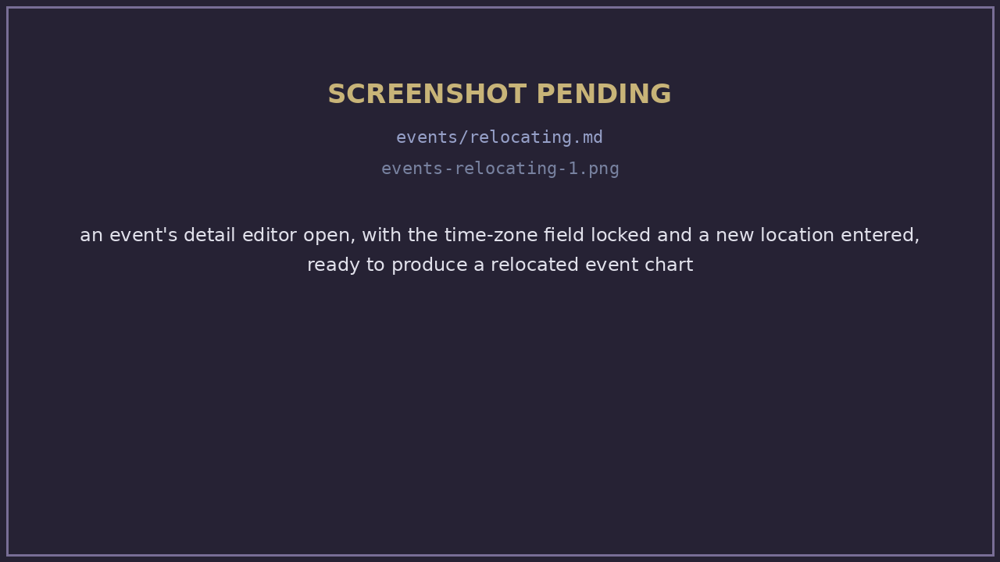

# Relocating an Event

The events in a search are all cast for the **chart's location** — the place tied to the
tab you are working in. Sometimes, though, you want to see how a single event would look
somewhere else: what was on the horizon at a different city when a transit came exact, or
how a return chart falls if you were away from home. Zodiac lets you relocate one event
without disturbing the rest of the list.

<figure markdown="span">
  { loading=lazy }
  <figcaption>an event's detail editor open, with the time-zone field locked and a new location entered, ready to produce a relocated event chart</figcaption>
</figure>

## How to relocate

1. **Click the event** in the [Events list](index.md) to select it.
2. **Edit its details** — open the event's editor and change the location to the place
      you want.
3. **Lock the time zone** so that relocating the event holds its moment in time while
      moving the observer, rather than reinterpreting the clock time at the new place.

Zodiac then produces an **individually relocated event chart** for that single event. The
rest of the search stays put, tied to the original location, so relocating one event is a
one-off inspection rather than a change to the whole tab.

!!! tip
    This is a quick way to compare an event across places — cast it at home, relocate a
    copy elsewhere, and read the two side by side in a bi-wheel.

---

**Next:** [Background finders &amp; performance](performance.md)
