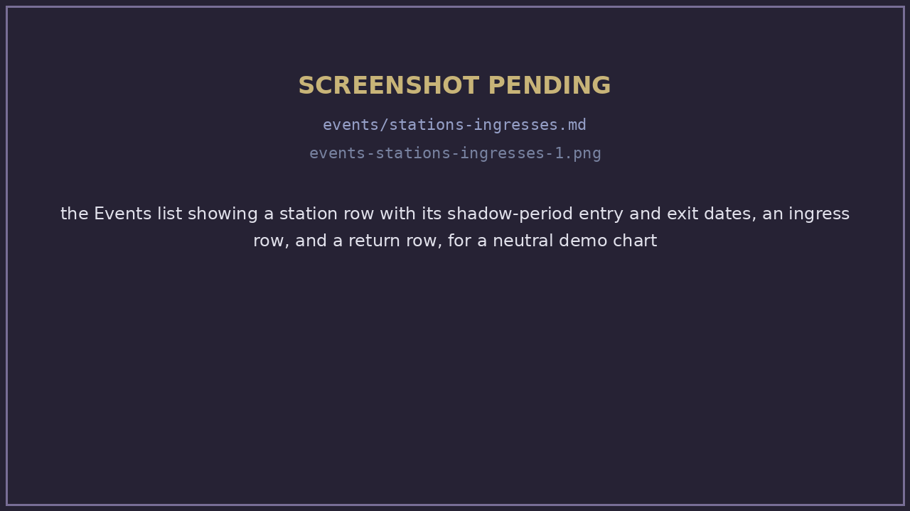

# Stations, Ingresses &amp; Returns

Alongside aspects, the [Events panel](index.md) reports three kinds of event that are
about a single body's own motion or timing: **stations**, **ingresses**, and
**returns**. Each has a filter on the [event-filter toolbar](toolbar.md), and each can
also be searched for by pattern.

<figure markdown="span">
  { loading=lazy }
  <figcaption>the Events list showing a station row with its shadow-period entry and exit dates, an ingress row, and a return row, for a neutral demo chart</figcaption>
</figure>

## Stations

A planet **stations** when it appears to stop and reverse direction — turning
retrograde, or turning direct again. Zodiac lists these turning points and, around each
one, demarcates the **shadow period**: the span over which the planet travels back and
forth across the same stretch of zodiac. The entrance and exit of the shadow are found
by searching for the transit of the station degree, so the whole retrograde episode —
not just the instant of the turn — is laid out for you. Search for them by pattern with,
for example, `Saturn station`.

## Ingresses

An **ingress** is a body crossing a boundary into a new division of the chart. Zodiac
tracks both **sign** ingresses (a planet entering the next zodiac sign) and **house**
ingresses (a planet crossing a house cusp). Sign index resolution is handled correctly
for forward and reverse (retrograde) crossings, so a planet that ingresses, retrogrades
back, and re-enters is reported faithfully. Search by pattern with `Mars ingress Aries`.

## Returns

A **return** is the moment a body comes back to its natal position. Zodiac finds
**solar** and **sidereal** returns, and — because returns integrate with the **current
harmonic setting** — a harmonic set turns them into **quarterly** or **demi-returns**.
Enter a harmonic (for instance H4) and select a return, and Zodiac generates the nearest
quarterly return, which may be the actual return. Each return event also carries a
summary of the aspects in orb at that moment, so you can read its flavor at a glance
before opening the chart.

!!! tip
    Because returns follow the harmonic setting, you never have to cast a demi- or
    quarti-return by hand — set the harmonic, pick the return, and the event engine finds
    the moment for you.

For the return charts themselves — how they are constructed and displayed — see
[Returns](../chart-types/returns.md).

---

**Next:** [Heliacal apparitions](heliacal.md) &nbsp;·&nbsp;
[Relocating an event](relocating.md)
