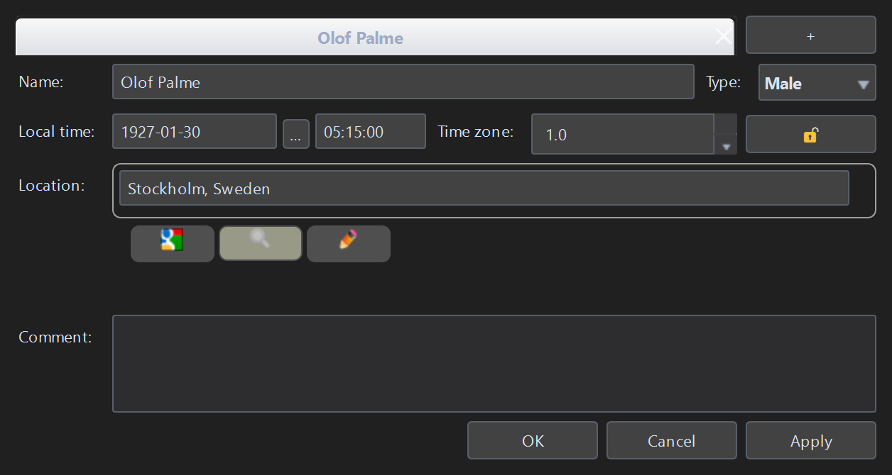

# Creating &amp; Editing Charts

To cast a chart in Zodiac you enter three things — a **date**, a **time**, and a
**place** — and the program draws the wheel. You do this in the file editor, which you
reach with the **New** button (for a fresh chart) or the **Edit** button (to change one
you already have). See [A tour of the main window](main-window.md) for where those buttons
are.

<figure markdown="span">
  { loading=lazy }
  <figcaption>the chart file editor, showing the name field and chart type, the local date, time and time-zone controls, the location field, and the comment box</figcaption>
</figure>

## The file editor

The editor holds all the data that defines a chart: its name, its date and time, and its
location. Place lookup, time modes (Zone Time, LMT, LAT), and calendar handling all live
here too — those are covered in detail in [Locations, time &amp; calendars](location-time.md).

### Entering the date and time

Date and time are entered with the **AstroDateTimeEdit** control, a field built for
astrological work rather than everyday calendars. It handles the awkward cases robustly:
**BC years** and **calendar suffixes** are entered directly, so historical charts cast
correctly instead of tripping over the limits of an ordinary date picker.

## Chart file types

Every chart has a **type**. The most common is a plain **natal** chart, but Zodiac also
stores a range of **derived** chart types — **returns**, **progressions**, **composites**,
and others — plus an **"Other"** catch-all. Choose the type from the file-type dropdown in
the editor. For what each type means and how to work with it, see
[Chart Types](../chart-types/index.md).

### The basis chart

A derived chart is derived *from* something — a return is a return to a natal chart, a
progression progresses one. When you pick a derived type, the editor offers a **basis-chart
selector** so you can point the new chart at the chart it is based on. The selector looks
through your database, including subfolders, to find candidate charts.

## Saving and loading

Save the current chart with **Save Chart**; use **Save As** when you want to keep the
original and write a copy under a new name. Loading is **resilient to legacy formats** —
older chart files, including ones saved by earlier versions, open without fuss — so your
existing collection carries forward.
