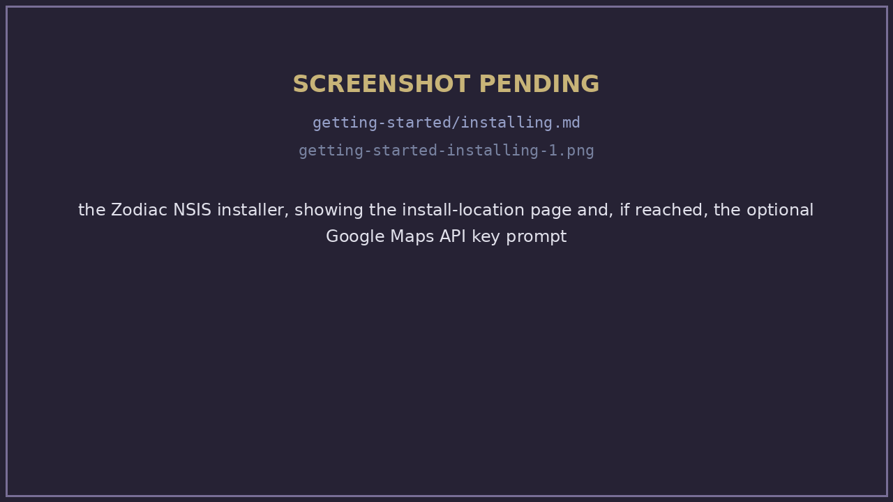

# Installing Zodiac

Zodiac ships as a single Windows installer, built with the Nullsoft Scriptable Install
System (NSIS). Download the latest version, run the installer, and follow the prompts.

<figure markdown="span">
  { loading=lazy }
  <figcaption>the Zodiac NSIS installer, showing the install-location page and, if reached, the optional Google Maps API key prompt</figcaption>
</figure>

## What the installer sets up

The installer is self-contained — it packages everything the program needs to run, so
there is nothing else to download:

- the required **Qt runtime libraries (DLLs)**;
- the application's **resources** — images, styles, and interpretation text;
- the **fonts** Zodiac renders its glyphs and tables with — **Almagest** (the
    astrological glyph font) and the **DejaVu** family (DejaVu Sans, DejaVu Sans Condensed,
    and DejaVu Serif) — which it installs into the Windows Fonts directory and registers so
    the glyphs display correctly; and
- the **Swiss Ephemeris data files** used for all astronomical calculations.

During installation you may also be offered an **optional Google Maps API key** field.
This key enables online place and time-zone lookup; you can enter it now or add it later.
See [Locations, time &amp; calendars](location-time.md) for what the key is for and how to
supply one afterward.

## Where your files live

Zodiac keeps your work and your settings out of the install directory so they are easy to
back up or sync to the cloud:

- **Sessions and settings** are stored under **`Documents/zodiac-charts`**.
- The **Google Maps API key** is kept separately in **`APIKey.ini`** in the installation
    directory — it is deliberately not written into your settings file.

## Building on Linux

Zodiac also builds and runs on **Linux from source**. You will need **Qt 6.10.x or
6.11.x**, the **Boost** C++ libraries, **CMake**, and a **C++17** compiler. This is a
developer path rather than a packaged download; for the full build steps and the current
requirements, see the **repository README**.
