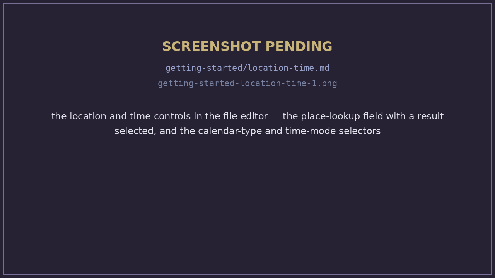

# Locations, Time &amp; Calendars

Casting an accurate chart means pinning down *where* and *when* precisely — the right
latitude and longitude, the right time zone, and the right calendar for the era. Zodiac
handles all three in the file editor.

<figure markdown="span">
  { loading=lazy }
  <figcaption>the location and time controls in the file editor — the place-lookup field with a result selected, and the calendar-type and time-mode selectors</figcaption>
</figure>

## Finding a location

Type a place name and Zodiac looks it up. There are two paths to a result:

- **Online lookup** uses **Google services** to resolve a place to its **latitude and
    longitude** and to determine its **time zone**. This requires a **Google Maps API key**
    that you supply — either during installation, or by placing it in `APIKey.ini` in the
    install directory. See [Installing Zodiac](installing.md) for where that file lives.
- **Offline lookup** uses a **bundled GeoNames city database** (it prefers the
    `cities500` dataset when present). This built-in database is used for **transit
    time-zone resolution** and for **paran-latitude lookups**, and it also serves as a
    fallback when online lookup is unavailable. In fact transit time zones now resolve from
    the local database first, only falling back online when the local zone can't be found.

When no API key is set, place lookup starts on the offline database; with a key it starts
on Google. You can switch between them with the button beside the place field.

The offline database is what powers place-based paran work — see
[Paran latitude bands &amp; city lookup](../parans/latitude-bands.md).

## Time modes

Once the place is set, choose how the clock time should be interpreted:

- **Zone Time** — ordinary civil (time-zone) time, the usual choice for modern charts.
- **LMT** — local mean time, the mean-sun clock time for the exact longitude.
- **LAT** — local apparent time, sundial time, which differs from mean time by the
    **equation of time**.

Zodiac applies the equation of time when converting between these modes, so LMT and LAT
values round-trip exactly. This matters most for historical charts, where civil time
zones did not yet exist.

## Calendars

The **calendar type** can be set to **Auto**, **Gregorian**, or **Julian**. Auto picks
the calendar in civil use at the chart's date, which is the safe default; the explicit
settings let you override it when you need to. Together with the time modes and the
equation-of-time handling, this keeps **historical dates correct** — the reform from the
Julian to the Gregorian calendar is accounted for rather than silently ignored.

!!! tip
    For a modern birth chart you rarely need to change anything here: leave the calendar
    on **Auto** and the time on **Zone Time**. Reach for the other options when you are
    casting a chart from before the calendar reform, or working from a source that gives
    LMT or apparent time.
