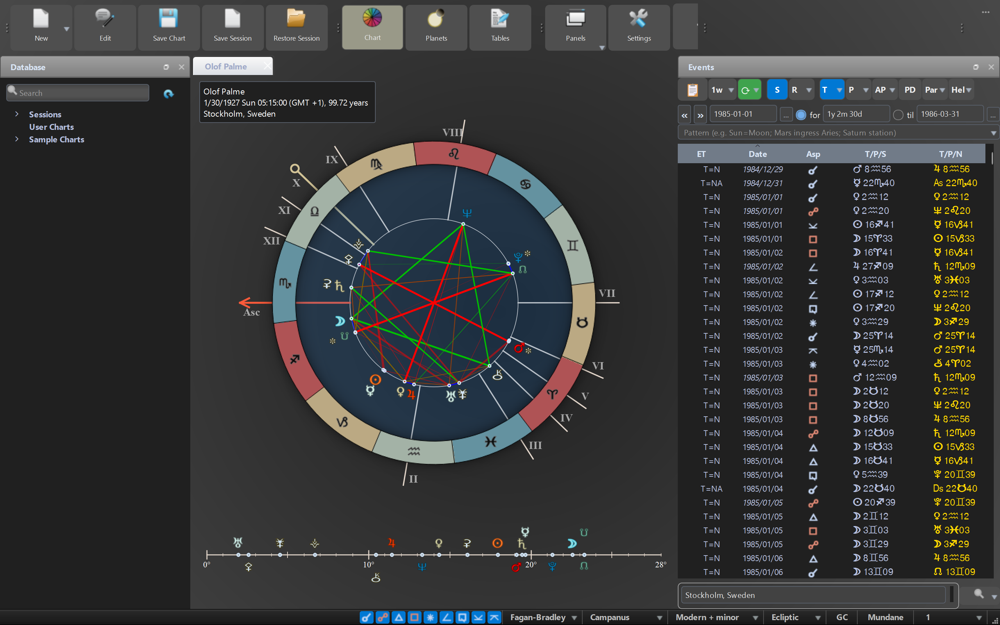
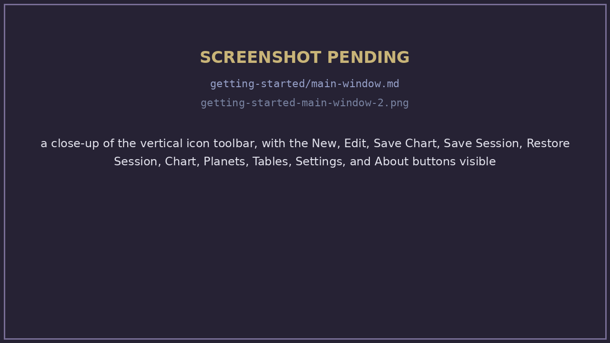
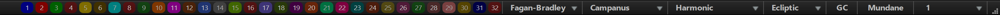

# A Tour of the Main Window

Zodiac's window is compact and dock-based: a set of panels arranged around a central
chart area. The panels can be moved, floated, or hidden, so you can arrange the interface
to suit the work you are doing. What follows describes the default layout.

<figure markdown="span">
  { loading=lazy }
  <figcaption>the whole main window — the database tree on the left, the toolbar of icon buttons across the top, the tabbed chart area in the center, the Events panel docked on the right, and the status bar along the bottom</figcaption>
</figure>

## The database tree (left)

Down the left edge is the **chart database** — a tree of your saved charts and sessions,
organized into folders you create. Open a chart from here and it appears in the central
area. Sessions live in the same tree. See [The chart database](../organizing/database.md)
and [Sessions &amp; multi-window](../organizing/sessions.md) for organizing your work.

## The toolbar (top)

A row of **icon buttons** runs across the top of the window. From left to right, they
let you:

- **New** — start a new chart.
- **Edit** — open the file editor for the current chart.
- **Save Chart** — save the current chart to the database.
- **Save Session** — save the current set of open tabs as a session.
- **Restore Session** — reload a previously saved session.
- **Chart**, **Planets**, **Tables** — switch the central area between the chart wheel,
    the planets view, and the text tables. See [The Views](../views/index.md).
- **Panels** — show or hide the docked panels (Database, Details, Harmonics, Events,
    Speculum).
- **Settings** — open the settings editor (zodiac, houses, aspects, orbs, and more). See
    [Settings reference](../reference/settings.md).
- **About** — program information and credits.
- **Help** — open this help. ++f1++ opens the page for whatever is under focus or the mouse.

When the window is too narrow for every button, the last ones move into the toolbar's
**»** overflow menu at its right-hand end.

<figure markdown="span">
  { loading=lazy }
  <figcaption>a close-up of the toolbar across the top of the window, with the New, Edit, Save Chart, Save Session, Restore Session, Chart, Planets, Tables, Panels and Settings buttons</figcaption>
</figure>

## The chart area (center)

The **central area is tabbed** — each open chart or bi-wheel gets its own tab — and it
shows the current chart in whichever view you have chosen: the chart wheel, the planets
view, or the text tables.

## The Events panel (right)

Docked on the right is the **Events panel**, where Zodiac searches a date range for
transits, progressions, stations, ingresses, returns, parans, and heliacal apparitions.
It is the most actively developed part of the program — see
[Events (Transits)](../events/index.md).

## The status bar (bottom)

Along the bottom is a **status bar** with the zodiac, house-system, aspect-set,
aspect-mode and harmonic controls. When the aspect set is **Harmonic**, it also carries
the **dynamic-harmonic buttons, H1 through H32**. Click a button to add or remove that
harmonic's aspect lines on the chart wheel, so you can build up exactly the set you want
to see — the Ptolemaic aspects, for example, are H1, H2, H3, H6, and H8. See [Harmonics on the wheel](../chart-wheel/harmonics.md).

<figure markdown="span">
  { loading=lazy }
  <figcaption>the status bar along the bottom of the window with the Harmonic aspect set selected, showing the row of H1–H32 harmonic toggle buttons with several of them active</figcaption>
</figure>
