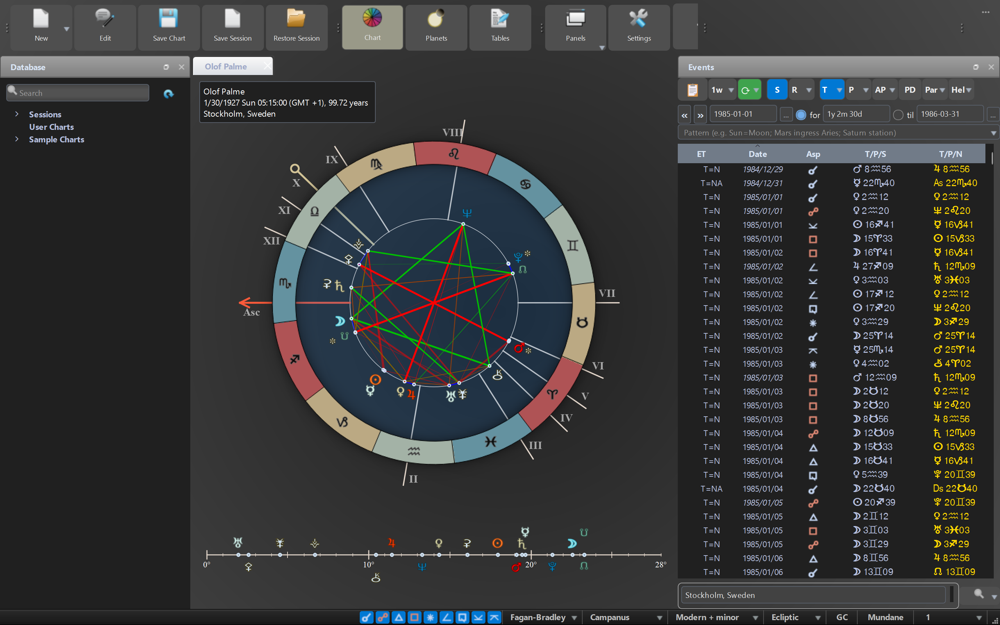

# Zodiac

**Zodiac** is a desktop application for casting and studying horoscopes. It draws
classical chart wheels, a planets view, and text tables; it works in both the
**tropical** and **sidereal** zodiacs; and it reaches well beyond a typical charting
program into harmonics, parans, primary directions, and a fast, pattern-driven
event engine for transits and directions.

This site is the built-in help. You can reach it any time from inside the program by
pressing ++f1++ or clicking **Help**, and you can also read it online.

<figure markdown="span">
  { loading=lazy }
  <figcaption>the main window — database tree on the left, chart wheel in the centre, the Events panel on the right</figcaption>
</figure>

## What Zodiac does

At its simplest, you enter a date, time, and place and Zodiac draws the chart. From
there the program opens up in several directions:

- **Multiple views of the same chart** — a classical wheel, a planets view, and text
  tables, each kept in sync as you change display options.
- **Tropical and sidereal** — the tropical zodiac plus three sidereal options: a
  non-equal "constellational" ayanamsha, and the two equal-sign 30° ayanamshas,
  **Fagan–Bradley** (Aldebaran fixed at 15° Taurus, favoured by Western siderealists)
  and **Lahiri** (Spica at 0° Libra, standard in Jyotish).
- **Nine house systems and over forty aspects**, with adjustable orbs and filtering.
- **Harmonics from H1 to H32**, shown dynamically on the wheel and explored in a
  dedicated Harmonics tab — including "overtones", so you can see the H4 pattern inside
  an H9 chart, or vice-versa.
- **Fixed stars, midpoints, and multiple coordinate frames** — ecliptic, prime
  vertical, equatorial, and great-circle aspects.
- **Parans and primary directions** — paranatellonta event finding, an interactive
  speculum, and several quotidian direction methods.
- **A fast event engine** — transits-to-transits, transits-to-natal, progressions,
  stations, ingresses, returns, and heliacal apparitions, searchable with a compact
  pattern language.

## The idea behind it

Most of Zodiac's power is reached not by casting a new chart for every question, but by
**navigating through time and through a chart's features from tables** — the events
table, the speculum, the harmonics table, the directions tables. Rather than manually
building a return chart, or a progressed chart, or hunting for the moment an aspect is
exact, you set a range and let the tables find the moments for you; clicking a row brings
up the corresponding chart. The program is, at heart, **chart- and table-based**, and
that is the quickest way to get comfortable with it.

The interface is compact and dock-based, and you can arrange the toolbars and tables
where you like. It may feel a little quirky if you are used to a commercial package, but
the underlying model is simple.

## A note on this program's heritage

Zodiac began as an open-source project by **Artem Vasilev**. Josh Baudhuin found it on
SourceForge in 2015 — a clean, Qt-based, Swiss-Ephemeris charting program with a nice
dark theme, aspect sets, a planetary-strength scoring system, and a simple chart
database — and began adding features for western-sidereal and harmonic work. When the
original author stepped back from the project, that work became this independent
**sidereal branch**, developed since then to add sidereal ayanamshas, harmonic search,
parans, primary directions, and the event engine. It is free software, built on the
[Swiss Ephemeris](https://www.astro.com/swisseph/) for its astronomical calculations.

## How this guide is organized

- :material-rocket-launch: **[Getting Started](getting-started/index.md)**

    Install the program, take a tour of the window, and cast your first chart.

- :material-chart-donut: **[The Chart Wheel in Depth](chart-wheel/index.md)**

    Zodiacs, houses, aspects, harmonics, fixed stars, midpoints, and animation.

- :material-calendar-clock: **[Events (Transits)](events/index.md)**

    The event engine and its pattern search — the part under most active development.

- :material-star-four-points: **[Parans & Primary Directions](parans/index.md)**

    Paranatellonta, the speculum, and quotidian direction methods.

- :material-folder-multiple: **[Chart Types](chart-types/index.md)**

    Returns, progressions, composites, and bi-wheels.

- :material-cog: **[Reference](reference/index.md)**

    Every settings tab, themes, command-line options, and troubleshooting.

## Getting help fast

Inside the program, pressing ++f1++ opens the page most relevant to whatever you are
looking at — so ++f1++ from the Events panel lands on the Events guide, not the top of
the manual. If you prefer, the **Help** button and menu open this same site. Every page
is searchable from the search box at the top.
