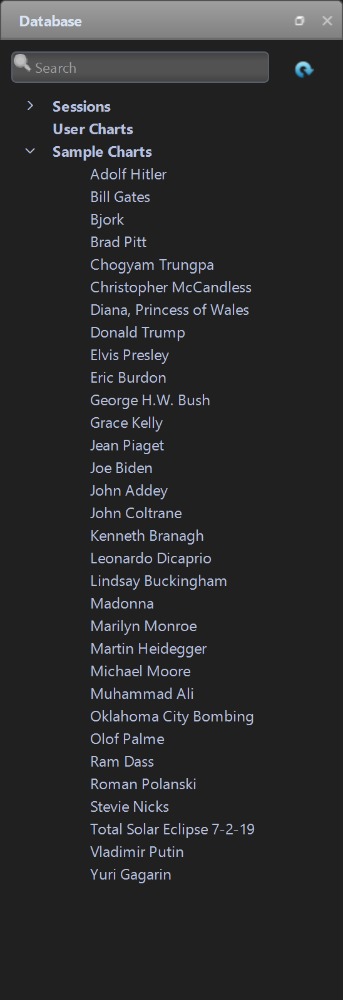

# The Chart Database

The **chart database** is the panel that lists your saved charts as a folder
tree. It is not a hidden, proprietary store — it is simply a view onto ordinary
files in your Documents folder (typically `Documents/zodiac-charts`), so the way
you organize charts here is the way they are organized on disk.

<figure markdown="span">
  { loading=lazy }
  <figcaption>the chart database panel down the left side of the window, showing a folder tree with a couple of subfolders expanded and several demo charts inside them</figcaption>
</figure>

## Folders and subfolders

You can group related charts into folders, and folders within folders — for
example a folder for family charts, another for mundane charts, or a folder per
research project with dated subfolders inside it. Create a folder from the
database panel, give it a name, and drag charts into it. There is no fixed depth,
so you can nest subfolders as far as your organizing scheme needs.

## Moving and copying charts

Charts can be **moved** from one folder to another, or **copied** so the same
chart lives in more than one place. The quickest way is **drag-and-drop**: pick
up a chart in the tree and drop it onto the folder where you want it. This makes
reorganizing a large collection fast — rearrange the tree until it matches how
you actually think about your charts.

## Recent charts

The charts you have opened most recently are kept close at hand, so returning to
something you were just working on does not mean digging back through the tree.

## Keeping charts everywhere: cloud storage

Because your charts are real files in your Documents folder, you can point any
cloud-storage service — OneDrive, Dropbox, iCloud Drive, and the like — at that
folder and have your whole collection sync automatically. Open Zodiac on another
machine that syncs the same folder and your charts are already there, arranged in
the same tree.

!!! tip
    The same is true for backups. Copying the `zodiac-charts` folder is enough to
    back up every chart, and your [sessions](sessions.md) live in the same user
    area, so they are backed up alongside them.
