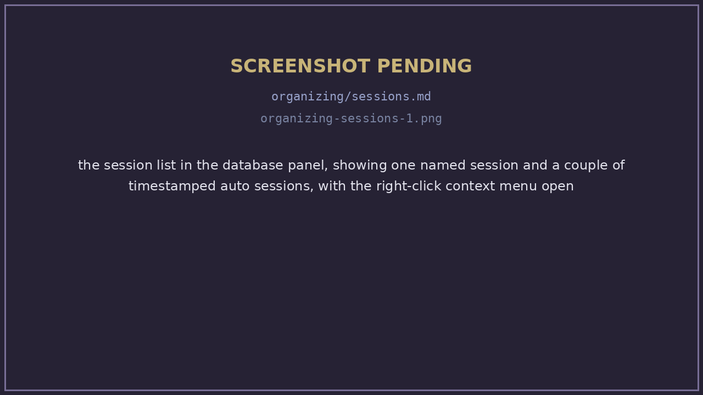

# Sessions &amp; Multi-Window

A **session** is the whole state of your workspace: every open chart, its tabs,
the view each one is showing, the transit date ranges you set, and the dock
layout you arranged. Zodiac saves this automatically and restores it the next
time you launch, so you can close the program mid-thought and pick up exactly
where you left off.

<figure markdown="span">
  { loading=lazy }
  <figcaption>the session list in the database panel, showing one named session and a couple of timestamped auto sessions, with the right-click context menu open</figcaption>
</figure>

## Auto sessions vs. named sessions

By default your work is kept in a **timestamped auto session** — a file the
program writes for you as you go, so nothing is lost between runs. When a piece
of work is worth keeping separate, use **Save Session As** to promote the current
session and give it a name. From then on the session has a tidy name of your
choosing, your automatic saves update that named session, and the name appears in
the **title bar** (for example, *Zodiac – My Research Session*), so you always
know which workspace you are in.

Session files use the **`.zos`** extension (Zodiac Session) and are stored in
your user documents area, alongside your charts — so they sync and back up the
same way. Double-clicking a `.zos` file opens it in Zodiac.

## Managing sessions from the database

Sessions appear in the database panel. Right-click one for the actions you need:

- **Open in New Window** — launch that session in a separate instance, so you can
    compare two workspaces side by side.
- **Load in Current** — import the charts from a saved session into the workspace
    you already have open.
- **Rename** — give a timestamped session a proper name, or change an existing one.
- **Delete** — remove a session file you no longer need.

## One window, or several

Zodiac runs as a **single instance** by default: if it is already open and you
launch it again, the existing window is simply raised to the front rather than a
second copy starting. When you genuinely want more than one workspace at once, you
can start additional instances using command-line flags — `--new` for a fresh
session, or `--load-session` to open a specific one. See
[Command-Line Options](../reference/command-line.md) for the full list.
