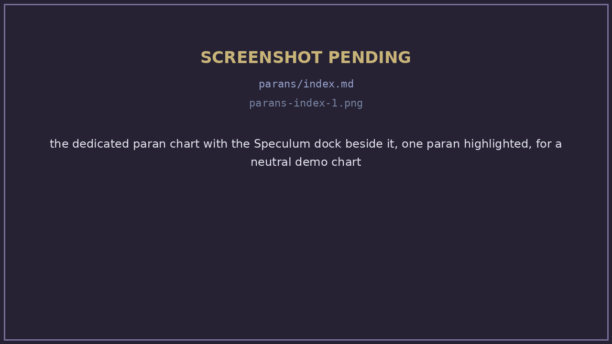

# Parans &amp; Primary Directions

This section covers one of Zodiac's most distinctive corners: **paranatellonta**
(parans for short) and the **primary-direction** timing bound up with them. If you have
used other astrology software, be aware that Zodiac treats these techniques in a
deliberately particular way — the design choices below are what make the feature its own.

<figure markdown="span">
  { loading=lazy }
  <figcaption>the dedicated paran chart with the Speculum dock beside it, one paran highlighted, for a neutral demo chart</figcaption>
</figure>

## What a paran is

A **paran** is an angular coincidence between two bodies. When one body is on an angle —
rising, culminating, setting, or anti-culminating (at the lower meridian) — and, at that
same instant and place, a second body is *also* on an angle, the two are said to be *in
paran*. The bodies need not share the same angle: a planet rising while a star culminates
is as much a paran as two planets rising together. Because the coincidence depends on the
diurnal (daily) turning of the sky at a specific latitude, parans are a fundamentally
**mundane** phenomenon rather than a zodiacal one — they live in the sky's rotation, not
in ecliptic longitude.

Zodiac finds two kinds of paran participant: **planet-to-planet** and
**planet-to-star**. The fixed stars come from a curated default selection.

## Why Zodiac's treatment is distinctive

Our implementation makes several opinionated choices, and it helps to know them up
front:

- **Parans carry an effective date.** Rather than presenting parans as timeless facts,
    Zodiac groups them with primary-direction timing so that each paran gets an
    **effective date** — roughly, when the angle acting as significator "meets" the other body by direction. This ties a static angular relationship to a moment in a life.
- **Star-to-star parans are excluded.** Only planet-to-star (and planet-to-planet) parans
    are kept. Two fixed stars in paran with each other are not reported, on the view that a
    star matters when it engages a *planet*.
- **Idle stars are filtered out.** A fixed star that is not involved in any paran with a
    planet is automatically dropped from the display, so you are not wading through stars
    that have nothing to say for this chart.
- **Results are grouped by orb.** Tighter coincidences are separated from looser ones, so
    the strongest parans stand out.

!!! note
    The paran and primary-direction calculations are, by the maintainer's own account,
    somewhat idiosyncratic: the angular transit time of each body is used directly as a
    kind of primary motion, rather than rotating the *primum mobile* around fixed angular
    placements as classical primary directions are usually computed. It is a defensible
    approach, but not the conventional one — keep that in mind when comparing Zodiac's
    numbers with another program's.

## Where to go next

- **[Paranatellonta](paranatellonta.md)**

    Finding paran events over a date range, the dedicated paran chart, and the bi-wheel
    prime-vertical display for visual inspection.

- **[The Speculum](speculum.md)**

    The rise / culmination / setting / anti-culmination table, and how it drives paran
    identification.

- **[Primary directions &amp; quotidian modes](primary-directions.md)**

    Primary directions in plain terms, the mundane directions table, and the SQ / NeoSQ /
    PSSR / NeoPSSR methods.

- **[Paran latitude bands &amp; city lookup](latitude-bands.md)**

    A text-based astro-locality tool for finding where a paran is sharper or softer.

