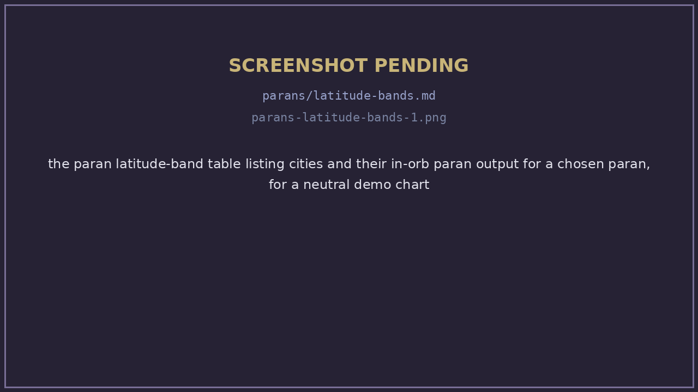

# Paran Latitude Bands &amp; City Lookup

A paran depends on **latitude**: two bodies that fall exactly on angles together at one
place may miss each other, or coincide more sharply, at another. Zodiac uses this fact to
offer a text-based **astro-locality** tool — a separate paranatellonta table that reaches
**beyond the chart's own locality** to show where a given paran plays out differently.

## What it does

Think of it as a text-based cousin of astrocartography. Rather than drawing lines across a
map, the table **lists cities** and shows, for a chosen paran, where that coincidence is
more or less **acute**. A paran that is loose at your birthplace might be tight a few
hundred miles north; this table lets you find those places.

The practical use is relocation-flavored: it helps you find places where you might want to
**seek** a favorable paran, or **avoid** an unwelcome one, without casting a chart for
every candidate city by hand.

<figure markdown="span">
  { loading=lazy }
  <figcaption>the paran latitude-band table listing cities and their in-orb paran output for a chosen paran, for a neutral demo chart</figcaption>
</figure>

## How the lookup works

The tool draws on Zodiac's **built-in city database** for its **paran-latitude
lookup**, so it works offline without needing an online geocoding service. For each paran
it reports the **in-orb latitude band** — the range of latitudes over which the
coincidence holds — and the cities that fall within it, with clearer formatting for the
band output.

!!! note "Meridional parans are excluded"
    Parans formed **only on the meridian** — MC-MC, MC-IC, and IC-IC — are left out of
    this table. Meridian contacts are far **less location-specific** than horizon
    contacts (the meridian passage of a body barely depends on where you stand along a
    parallel), so including them would add rows that say little about place. Horizon-based
    parans, which shift meaningfully with latitude, are what this table is for.

## Locations and the city database

Because this feature is built on the same locality data the rest of the program uses,
it is worth knowing how Zodiac resolves places, coordinates, and time zones. That is
covered under [Locations, time &amp; calendars](../getting-started/location-time.md).

---

**See also:** [Paranatellonta](paranatellonta.md) &nbsp;·&nbsp;
[The Speculum](speculum.md) &nbsp;·&nbsp;
[Locations, time &amp; calendars](../getting-started/location-time.md)
