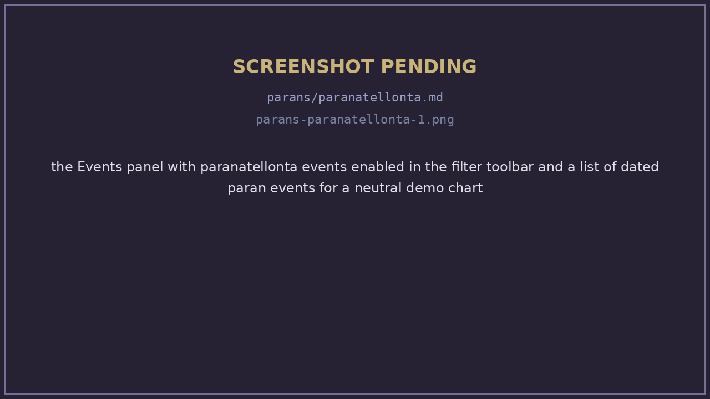
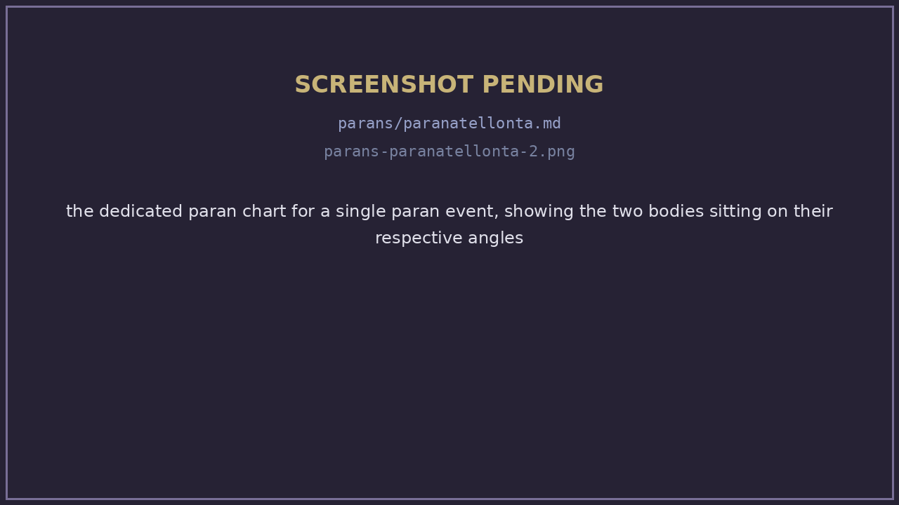
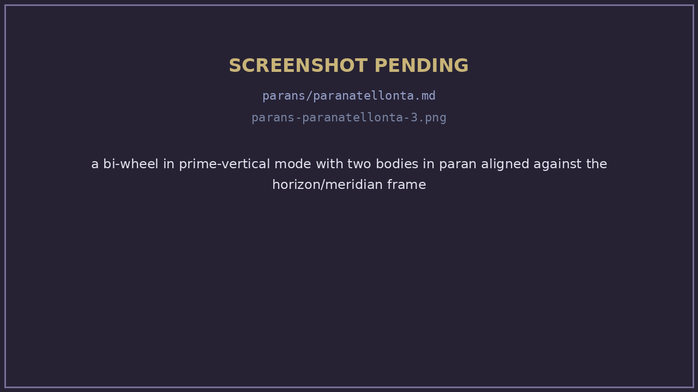

# Paranatellonta

Paranatellonta — parans — can be searched for over a span of time, the same way you
search for transits or stations. Zodiac then gives you a **dedicated paran chart** for
inspecting a given coincidence by eye, with a bi-wheel display mode built specifically to
make angular coincidences easy to see.

## Finding paran events over a range

Paran finding lives in the **Events panel**, alongside the other event types. Enable
paranatellonta events from the [event-filter toolbar](../events/toolbar.md), set a date
range, and Zodiac lists the paran events that fall inside it — each with the bodies
involved, the angles they occupy, and its worked-out timing. As with any event, clicking
a row brings the moment up on the chart so you can study it.

<figure markdown="span">
  { loading=lazy }
  <figcaption>the Events panel with paranatellonta events enabled in the filter toolbar and a list of dated paran events for a neutral demo chart</figcaption>
</figure>

**Transit-to-natal parans** are supported: the moving sky can form a paran against the
positions of the birth chart, not only against itself. This lets you track when a transit
brings a body onto an angle in coincidence with a natal body.

## The paran chart

For close visual inspection, Zodiac provides a dedicated paran chart UI. It is built
around the fact that a paran is about *where bodies sit relative to the angles* at a
single instant, so the display is arranged to make those angular placements plain rather
than burying them in a conventional ecliptic wheel.

<figure markdown="span">
  { loading=lazy }
  <figcaption>the dedicated paran chart for a single paran event, showing the two bodies sitting on their respective angles</figcaption>
</figure>

## The bi-wheel prime-vertical display

The most useful view for parans is the **bi-wheel prime-vertical (PV) display mode**. In
this mode the two charts of a bi-wheel are properly coordinated — they share a common
reference frame — so a body genuinely on the horizon or meridian *appears* on the horizon
or meridian, without the distortion you get from reading angular position off an ecliptic
wheel. Because parans are precisely about bodies sitting on angles at the same moment,
this coordinated PV view is especially well suited to visualizing them: two bodies in
paran line up visibly against the frame.

The prime-vertical frame, and how it differs from the ecliptic, equatorial, and
great-circle frames, is covered under
[Prime vertical, equatorial &amp; great-circle](../chart-wheel/coordinate-frames.md).

<figure markdown="span">
  { loading=lazy }
  <figcaption>a bi-wheel in prime-vertical mode with two bodies in paran aligned against the horizon/meridian frame</figcaption>
</figure>

## Midpoints as paran participants

A paran chain need not be limited to whole bodies. Zodiac allows **synthetic midpoint
participants** in a paran chain — a midpoint between two bodies can itself take part in
the coincidence, positioned on the chart wheel from the chord midpoint. This extends paran
searching to the midpoint structures that matter in harmonic and sidereal work.

---

**See also:** [The Speculum](speculum.md) &nbsp;·&nbsp;
[Primary directions &amp; quotidian modes](primary-directions.md) &nbsp;·&nbsp;
[Paran latitude bands &amp; city lookup](latitude-bands.md)
