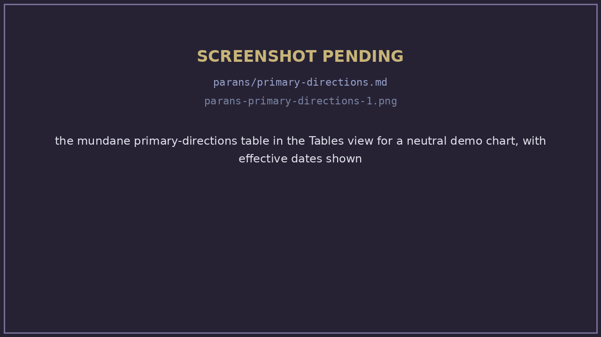
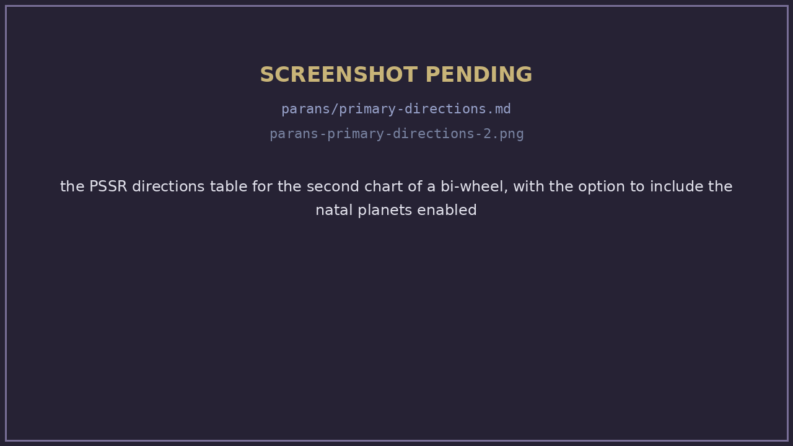

# Primary Directions &amp; Quotidian Modes

**Primary directions** are one of the oldest timing techniques in astrology, and Zodiac
generates them as tables you can read alongside a chart. This page explains the idea in
plain terms and describes the direction methods Zodiac offers.

## What a primary direction is

Everything in the sky appears to turn once a day: bodies rise in the east, culminate at
the meridian, set in the west, and pass the lower meridian, carried by the daily rotation
of the earth. This daily turning is the **primary motion** (also called *diurnal*
motion). In a primary direction, the angles and planets of a chart are "**directed**" by
this motion — you let the sky keep turning and watch for the moment a *promise* in the
chart is brought to perfection, such as an angle arriving at a planet or star.

The measurement is made in **right ascension** (position along the celestial equator,
which is what the diurnal rotation actually sweeps through), and the arc of that motion is
converted into time by a **rate**: as a rough rule, **1° of arc corresponds to about one
year of life**. Several rate conventions exist — the **Naibod** rate is a common one —
and they differ slightly in how many years a degree buys, which is why two programs can
report neighboring but not identical dates for the same direction.

!!! note
    Zodiac's parans are timed with exactly this machinery: each paran's **effective date**
    is the moment the directed angle-as-significator meets the other body. That is why the
    [Speculum](speculum.md) can tell you, on hover, when a body's mundane primary direction
    comes into play.

## The tables Zodiac generates

**Mundane primary directions.** For a chart, Zodiac produces a **mundane
primary-directions table** — directions worked in the mundane (angular) frame rather than
by zodiacal degree.

**PSSR for return charts.** For solar-return charts — including **demi-** and
**quarter-returns** — Zodiac instead generates **PSSR** (Progressed Sidereal Solar Return)
timing, a return-based directional scheme. See [Returns](../chart-types/returns.md) for
how those charts are cast.

<figure markdown="span">
  { loading=lazy }
  <figcaption>the mundane primary-directions table in the Tables view for a neutral demo chart, with effective dates shown</figcaption>
</figure>

## Direction methods (quotidian modes)

The directional method is resolved **per chart**, and four modes are available, all from
the **solar-quotidian** family:

- **SQ** — solar quotidian.
- **NeoSQ** — the "Neo" variant of SQ.
- **PSSR** — Progressed Sidereal Solar Return.
- **NeoPSSR** — the "Neo" variant of PSSR.

The distinction between the plain and **"Neo"** variants is which Sun they reference: the
Neo variants use the **apparent Sun's right ascension** rather than the **mean Sun's**.
That choice shifts the timing slightly and can be selected to match the convention you
prefer.

## Including natal planets in a bi-wheel

When you build the primary-directions or PSSR table for the **second chart of a
bi-wheel**, you can optionally have it **include the natal planets** as well, using their
**ex-precessed equatorial positions** — so the directions of the return (or other second
chart) can be read against the birth positions in one table.

<figure markdown="span">
  { loading=lazy }
  <figcaption>the PSSR directions table for the second chart of a bi-wheel, with the option to include the natal planets enabled</figcaption>
</figure>

---

**See also:** [The Speculum](speculum.md) &nbsp;·&nbsp;
[Returns](../chart-types/returns.md) &nbsp;·&nbsp;
[Paranatellonta](paranatellonta.md)
