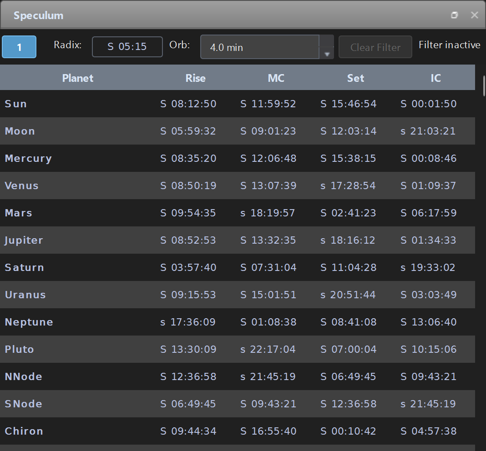

# The Speculum

A **speculum** is a table of angular timings. For each planet and each fixed star, it
lists when that body **rises**, **culminates** (crosses the upper meridian), **sets**, and
**anti-culminates** (crosses the lower meridian). Because a paran is simply two bodies on
angles at the same instant, a speculum is the natural place to spot parans — the
coincidences line up as matching times down the columns.

<figure markdown="span">
  { loading=lazy }
  <figcaption>the Speculum dock listing each body's rising, MC, setting and IC times for a neutral demo chart</figcaption>
</figure>

## Display modes

Each entry can be shown in one of three modes:

- **Right Ascension** — the body's position on the equator, in degrees.
- **Sidereal Time** — the local sidereal time of the angular contact.
- **Local Time** — the clock time of the contact.

The mode **syncs with the Tables view**: change the display mode there and the Speculum
follows, so the two stay consistent. (The Speculum lives among the text tables — see the
[Tables (text) view](../views/tables.md).)

## Reading and using the table

The Speculum is interactive, and this is where much of its value lies:

- **Hover** over an entry to see when its **mundane primary direction** comes into
    play — that is, the timing at which the angle acting as significator reaches that
    body. This is the bridge between the static angular table and a date in a life; the
    underlying method is described under
    [Primary directions &amp; quotidian modes](primary-directions.md).
- **Click** an entry to **filter** the display to every body that forms a paran with that
    body's angle transit. Instead of scanning the whole table by eye, you pick one angular
    contact and Zodiac shows you exactly which other bodies coincide with it.

## Working with cells

The Speculum supports the conveniences you would expect of a table:

- **Copy** the selected cells with ++ctrl+c++.
- **Extended selection** — select a range of cells to copy several timings at once.
- A dedicated **paran-orb setting** governs how close two angular contacts must be to
    count as a paran, so you can tighten or loosen what the click-to-filter and paran
    displays treat as a coincidence.

!!! tip
    The paran-orb setting and the radix-anchored clustering are shared between the
    Speculum and the directions tables, so a paran you tighten in one place stays
    consistent in the other.

---

**See also:** [Tables (text) view](../views/tables.md) &nbsp;·&nbsp;
[Primary directions &amp; quotidian modes](primary-directions.md) &nbsp;·&nbsp;
[Paranatellonta](paranatellonta.md)
