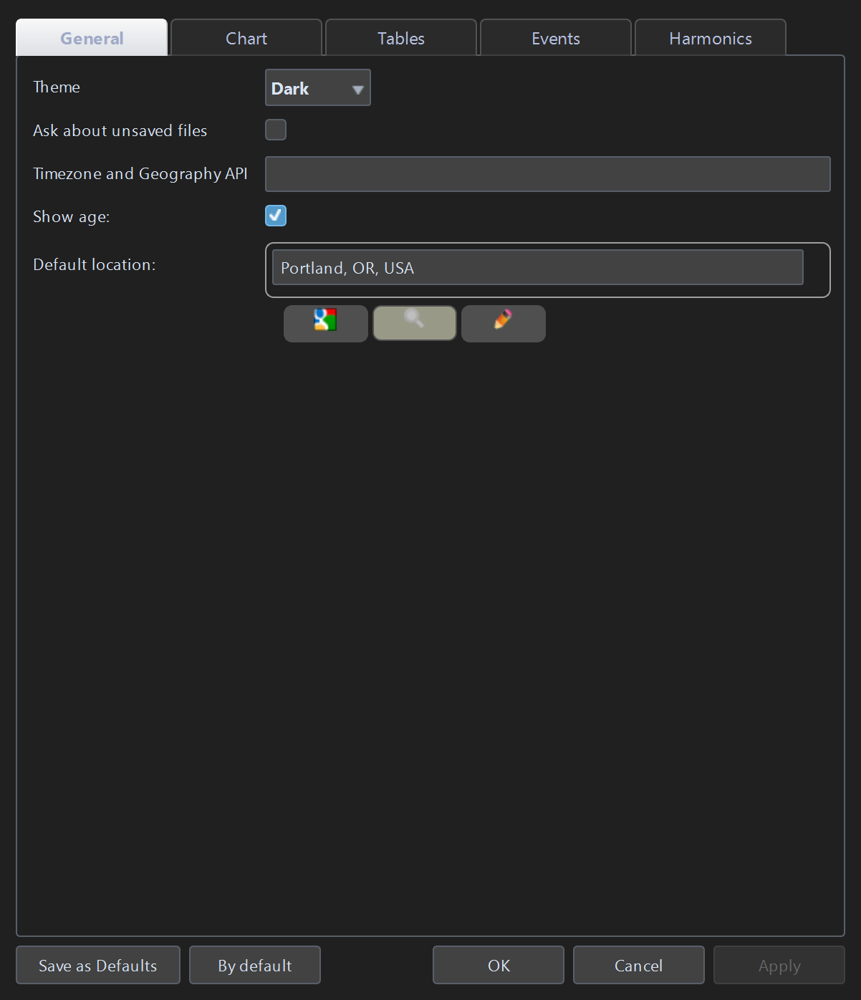
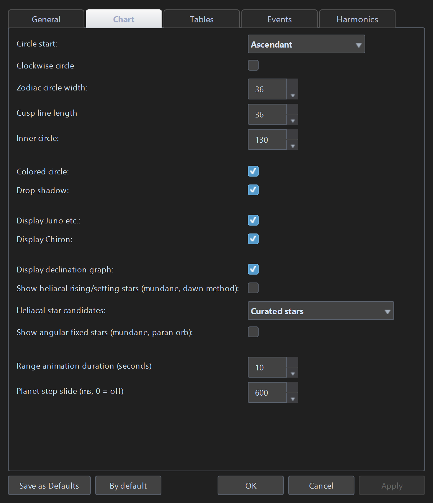
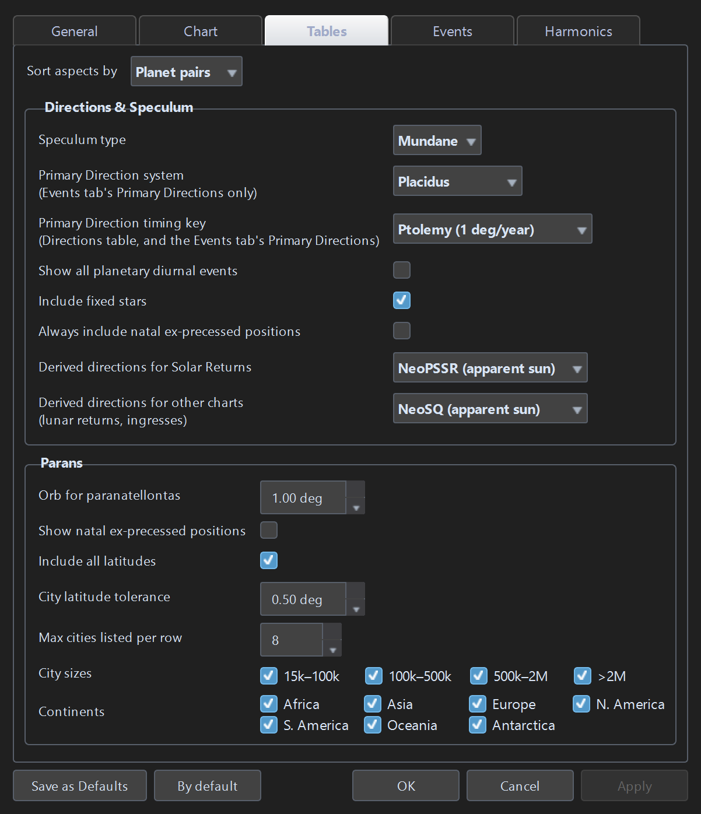
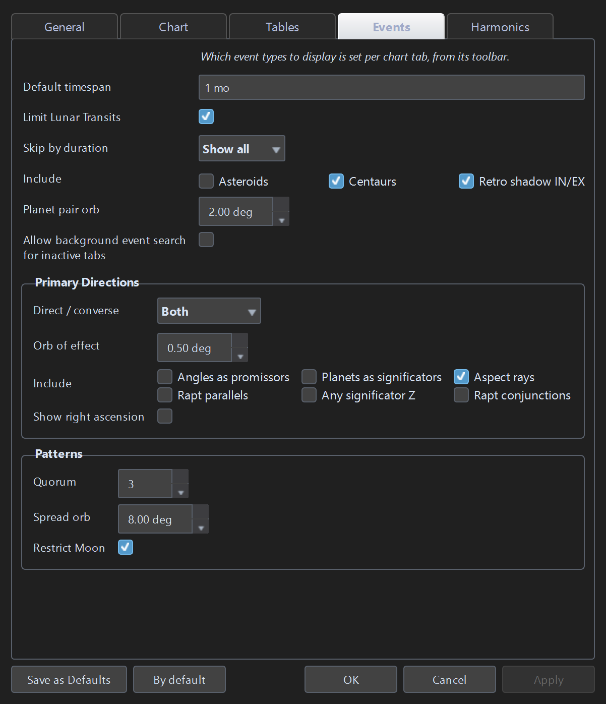
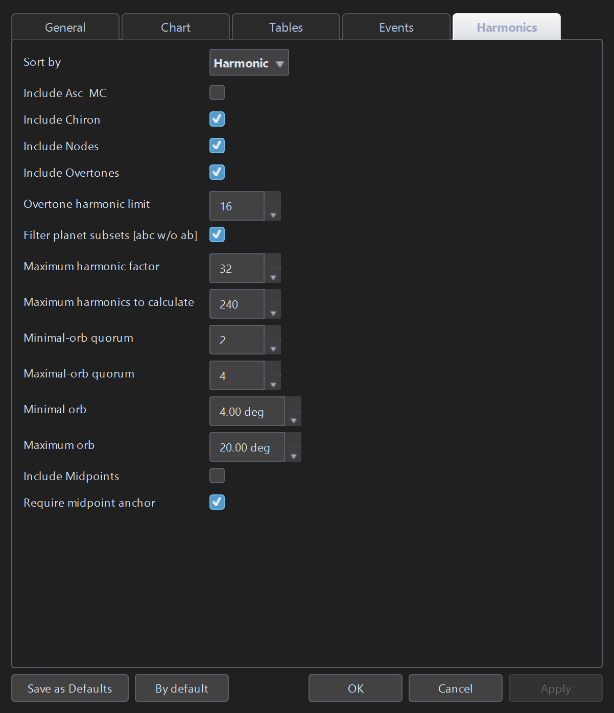

# Settings Reference

The **Settings** dialog is where you tune how Zodiac calculates and displays
charts. It is organized into tabs — **General**, **Chart**, **Tables**,
**Events**, and **Harmonics** — each grouping a related set of options. Your
choices **persist across sessions**, so what you set here is what you get next
time you open the program.

## General

The General tab holds the program-wide preferences:

- **Theme** — choose the Dark, Light, or Printable look (see [Themes](themes.md)).
- **Ask about unsaved files** — whether Zodiac prompts you before closing a chart
    that has unsaved changes.
- **Timezone &amp; Geography API** — the Google API key and endpoint used to look up
    the latitude, longitude, and time zone of places you enter. Location search
    needs a valid key; see [Locations, time &amp; calendars](../getting-started/location-time.md).
- **Show age** — whether a person's age is displayed alongside their chart.
- **Default location** — the place used for new charts and for transit searches
    when you have not specified one.

The tab also has the usual controls for **saving the current values as your
defaults**, **restoring the built-in defaults**, and **OK** / **Cancel** to apply
or discard your changes.

<figure markdown="span">
  { loading=lazy }
  <figcaption>the Settings dialog open on the General tab, showing the theme selector, the unsaved-files and show-age checkboxes, the Timezone and Geography API key field, the default location, and the Save as Defaults / By default / OK / Cancel / Apply buttons</figcaption>
</figure>

## Chart

The Chart tab governs how the **chart wheel** is drawn — the display options for
the wheel itself, such as what is shown around and inside it.

<figure markdown="span">
  { loading=lazy }
  <figcaption>the Settings dialog open on the Chart tab</figcaption>
</figure>

## Tables

The Tables tab governs the **text (Tables) view** — the options for how chart
information is presented in tables rather than on the wheel.

<figure markdown="span">
  { loading=lazy }
  <figcaption>the Settings dialog open on the Tables tab</figcaption>
</figure>

## Events

The Events tab holds the **defaults for event filtering and search** — the
starting points the Events panel uses before you adjust them per tab.

<figure markdown="span">
  { loading=lazy }
  <figcaption>the Settings dialog open on the Events tab</figcaption>
</figure>

## Harmonics

The Harmonics tab governs the **display and scope of harmonics** — controls such
as the minimum and maximum quorum, and the orbs used when gathering harmonic
patterns.

<figure markdown="span">
  { loading=lazy }
  <figcaption>the Settings dialog open on the Harmonics tab</figcaption>
</figure>
