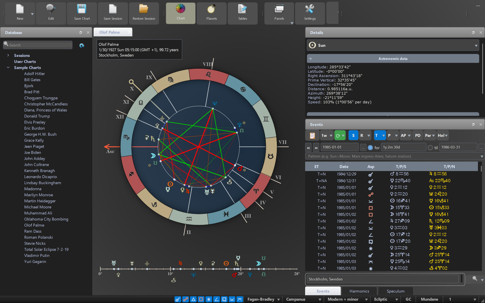
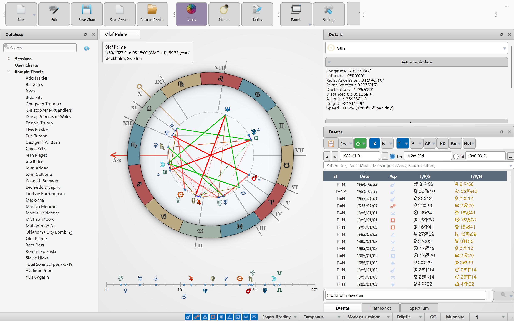

# Themes

Zodiac ships with three themes, so you can match the program to how and where you
are working:

- **Dark** *(default)* — a low-glare look tuned for comfortable viewing, including
    at night.
- **Light** — a clean, high-contrast interface for bright rooms and daytime work.
- **Printable** — an ink-saving black-and-gray variant, based on the light theme,
    for when you want to print a chart or a table without pouring toner into a dark
    background.

A theme applies to the **whole interface**, not just one panel — the menus,
toolbars, and docks, the **chart rendering** on the wheel, the **HTML output** of
the Plain and Details views, and the **tables**. Everything switches together, so
the program stays consistent whichever theme you choose.

Your choice **persists across sessions**: set it once and Zodiac remembers it the
next time you launch.

## Switching themes

Change the theme from the **General** tab of the Settings dialog — see the
[Settings Reference](settings.md). The interface updates as soon as you apply the
change, so you can see the effect immediately.

<figure markdown="span">
  { loading=lazy }
  <figcaption>the same demo chart shown in the Dark theme</figcaption>
</figure>

<figure markdown="span">
  { loading=lazy }
  <figcaption>the same demo chart shown in the Light theme, for side-by-side comparison with the Dark version above</figcaption>
</figure>

!!! tip
    Reach for the **Printable** theme just before printing or exporting a chart or
    table. It keeps the layout intact while dropping the dark fills that would
    otherwise waste ink.
