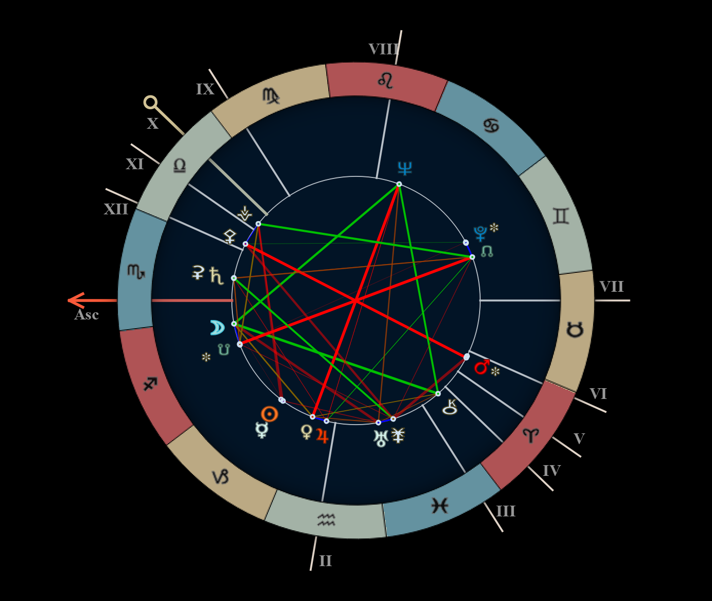

# The Chart Wheel

The **chart wheel** is Zodiac's default view and the one you will spend the most
time with. It is a classical wheel: the zodiac ring around the outside, the houses
divided within it, and the planets placed at their positions, all drawn from the
Swiss Ephemeris.

At a glance the wheel shows you:

- **The signs and houses** — the zodiac ring and the house divisions for the house
    system currently selected.
- **The planets**, laid out with their glyphs at their chart positions.
- **Aspect lines** between the planets, with **aspect intensity shown by line
    thickness** — a tighter, stronger aspect draws a heavier line, so the most
    significant contacts stand out.
- **Fixed stars near planets** — stars that fall within close direct (great-circle)
    distance of a planet are shown on the wheel.
- **Midpoint chords** — midpoint structures are drawn as chord lines between the
    planets involved.

<figure markdown="span">
  { loading=lazy }
  <figcaption>the chart wheel as the central view for a neutral demo chart — zodiac ring, house divisions, planet glyphs, and aspect lines of varying thickness across the center</figcaption>
</figure>

## There is much more to the wheel

The wheel is far more capable than this quick tour suggests. It can be redrawn for
any harmonic from H1 to H32, switched between the tropical and sidereal zodiacs,
shown in different coordinate frames (prime vertical, equatorial, great-circle),
paired with a declination strip, and animated through time.

All of those capabilities have their own section:

**[The Chart Wheel in Depth →](../chart-wheel/index.md)**
