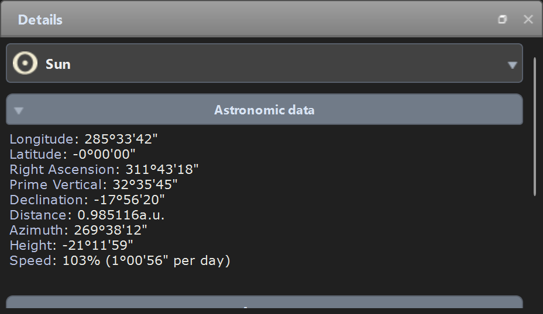

# Details

The **Details view** displays detailed properties and interpretations for a single
selected element — a planet or another chart element — rather than the chart as a
whole. Where the other views show the entire horoscope, this one goes deep on one
thing at a time: select an element and the view fills with its properties and the
relevant interpretive text.

It draws from the same open chart as the other views, so nothing is recast when you
switch to it. Its output is rendered as **theme-aware HTML**, so it follows the
current Dark, Light, or Printable theme and stays readable on screen and in print.

<figure markdown="span">
  { loading=lazy }
  <figcaption>the Details view for a neutral demo chart, showing the detailed properties and interpretation text for one selected planet</figcaption>
</figure>

!!! note
    For the planets as a group rather than one element in depth, see the
    [Planets view](planets.md); for the chart's data as text tables you can copy,
    see the [Tables (text) view](tables.md).
