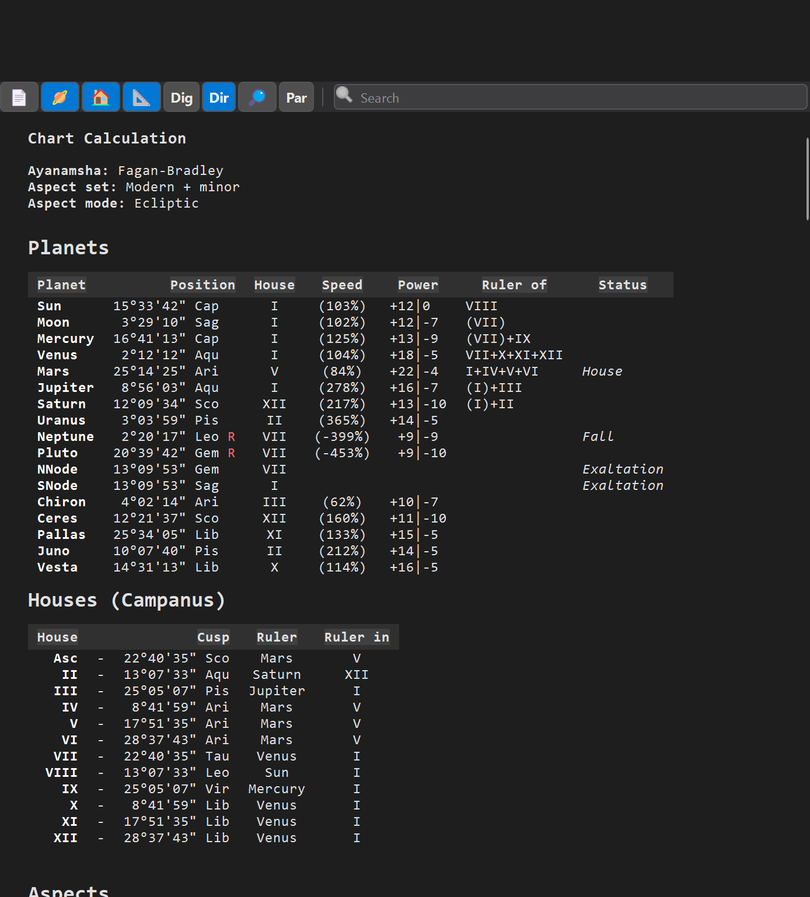

# Tables (Text) View

The **Tables (text) view** shows the chart's information as text tables in place of
the wheel. It is the view to reach for when you want to read the numbers, compare
values row by row, or copy data out — everything the wheel expresses as a picture,
laid out as text.

For a given chart it can present:

- **Positions** — the planets' positions.
- **House rulerships** — which planets rule which houses.
- **Aspects** — the aspects in the chart.
- **The Speculum** — rising, culmination, setting, and anti-culmination data for the
    bodies (see [The Speculum](../parans/speculum.md)).
- **Primary Directions and PSSR directions** — mundane primary-direction timings, and
    Primary Solar/Sidereal Return timings for return charts (see
    [Primary directions &amp; quotidian modes](../parans/primary-directions.md)).
- **Parans** — the paranatellonta tables.

<figure markdown="span">
  { loading=lazy }
  <figcaption>the Tables (text) view for a neutral demo chart, showing the text tables — Positions and one of the directions or paran sections — with the display-mode control and the per-section toggles visible in the toolbar</figcaption>
</figure>

## Display mode

A **display-mode control** switches how times and positions are expressed between
**Local Time**, **Sidereal Time**, and **Right Ascension**. This control is kept in
sync with the [Speculum](../parans/speculum.md) dock, so changing the mode in one
place updates the other.

## Showing and hiding sections

Because the view can hold a lot of material at once, compact per-section toggles
(the **SectionToggle** controls in the toolbar) let you show or hide individual
sections — turn off the tables you are not using and keep only what you want to read.

## Themes

The view's output is **theme-aware**: it follows the current Dark, Light, or
Printable theme, so the tables stay readable on screen and print cleanly.
